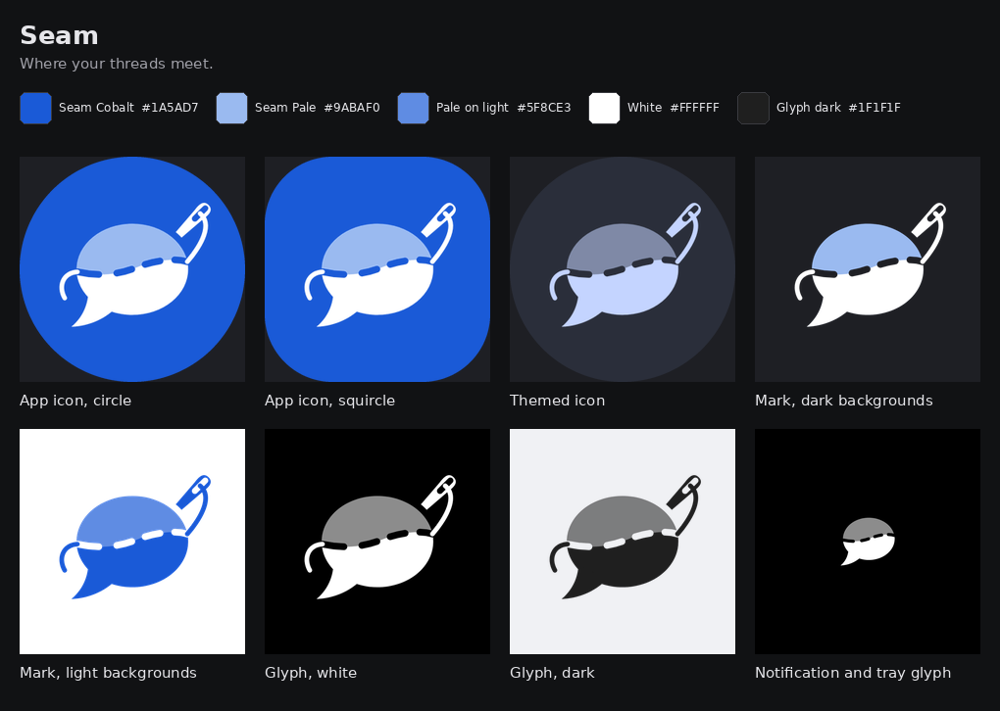

# Seam brand

**Seam** is this app's name. Tagline: **Where your threads meet.** One inbox for every network,
each conversation a thread, sewn together.

## The mark

A round speech bubble made of two pieces of fabric, sewn together and caught mid-stitch:

- **Bubble:** nearly circular, with a normal speech-bubble tail at the lower left.
- **Seam:** a gentle S across the middle, sewn as four stitches. It splits the bubble into two pieces of
  fabric: the piece above the seam in a paler tone, the piece below in the solid colour (see Colour).
- **Stitches:** four running stitches along the seam, cut out of the bubble.
- **Thread:** a free end hangs out and down from the first stitch at the left, where the seam started.
  The working thread runs from the last stitch at the right to the needle.
- **Needle:** sits behind the bubble, its eye out at the top right, separated from the bubble by a
  gap of background colour.

The thread and needle follow how hand sewing really works: the needle is always at the most recent
stitch, and the loose end is where the sewing began.

## Colour

| Name | Hex | Use |
|---|---|---|
| Seam Cobalt | `#1A5AD7` | Icon and launch-screen background; the mark's colour on light backgrounds; the app's default theme colour |
| White | `#FFFFFF` | Bubble, needle and thread; the glyph on dark backgrounds |
| Seam Pale | `#9ABAF0` | The piece above the seam when the bubble is white (app icon, launch screens, the mark on cobalt or dark) |
| Seam Pale on light | `#5F8CE3` | The piece above the seam when the bubble is cobalt on white or light (the mark on light, the tray on a light taskbar): cobalt 30% of the way to white, the lightest tint that keeps 3:1 against a light taskbar at 16 px |
| Glyph dark | `#1F1F1F` | The glyph on light backgrounds |

The one-colour glyphs (white, dark, `currentColor`, the Android notification and themed icons, the tinted
iOS icon, `seam_glyph.png`) draw the piece above the seam in the same colour at 55% opacity, so they keep
two tones however the app or the system tints them. In the app, a mark drawn in the theme's colour takes
that colour 30% of the way to white for the upper piece on a light surface and 45% on a dark one
(`SeamStitchPainter.lighter`); a white mark on cobalt takes Seam Pale (`SeamStitchPainter.periwinkle`), and
a mark standing in for the tinted glyph takes 55% opacity (`SeamStitchPainter.faded`).

In the app, Seam Cobalt is the default seed of the Material colour scheme (`AppConfig.primaryColor`
and the default of `AppSettings.colorSchemeSeedInt`), and the first colour in Settings > Style.
The system's dynamic colour is an option there, not the default.

Seam Cobalt was chosen to sit apart from other messaging blues (Google Messages `#1A73E8`, Signal
`#3A76F0`, Messenger `#0084FF`, LinkedIn `#0A66C2`).

## Which file for what

| Need | File |
|---|---|
| App icon, any size | `svg/seam-app-icon.svg` (square; launchers and stores apply their own mask) |
| Mark on a dark or cobalt background | `svg/seam-mark.svg` |
| Mark on a white or light background | `svg/seam-mark-on-light.svg` |
| One-colour glyph (status bar, notifications, UI) | `svg/seam-glyph.svg` (`currentColor`), or `-white` / `-dark` (upper piece at 55% opacity) |
| Android launcher icon | `android/res/` (adaptive icon: foreground, cobalt background, monochrome layer, plus legacy PNGs) |
| Android notification icon | `android/res/drawable/ic_stat_seam.xml` (a vector drawable written by `source/notification_icon.py`; the status-bar variant of the glyph: bubble, tail and stitches only, with no needle or thread, the upper piece at 55% alpha; it fills the 24 dp icon with a 1 dp margin on its longer side) |
| Play Store icon | `store/play-store-icon-512.png` (512 x 512, square, no rounding or shadow); `android/store/make-graphics.py` copies it to `android/store/icon-512.png` and draws the feature graphic |
| Windows | `windows/app_icon.ico` (exe, taskbar and installer), `tray_icon.ico` and `tray_icon_light_taskbar.ico` (the needle-free glyph for a dark or light taskbar), `titlebar_light.ico` and `titlebar_dark.ico` (the bare mark for a light or dark caption; not used by the app, which hides the native title bar) |
| Web | `web/favicon.svg`, `favicon.png` (16 px), `apple-touch-icon.png`, `icon-{16,32,48,192,512}.png`, `icon-maskable-{192,512}.png` (the mark inside the 80% safe circle) |
| iOS | `apple/ios/AppIcon.png` (light, opaque), `AppIcon-Dark.png` (the mark alone), `AppIcon-Tinted.png` (the one-colour glyph), `LaunchImage{,@2x,@3x}.png` (the tile at 192 pt); `apple/icon-composer/*.svg` are the layers for an iOS 26 `.icon`, built in Icon Composer on a Mac |
| macOS | `apple/macos/app_icon_{16..1024}.png` (Apple's 824 px grid with its shadow; 64 and 32 drawn from the vector at size, 16 from the needle-free vector) |
| Raster sizes | `png/` (app icon square and round, marks, glyphs) |

### Where the app uses it

The build copies these into the app (the INSTALL step at the end of `source/build_brand.py`):

| In the app | Copied from |
|---|---|
| `android/app/src/main/res/drawable-*/ic_launcher_foreground.png`, `ic_launcher_monochrome.png` | `android/res/mipmap-*/` foreground and monochrome layers (the adaptive icon in `mipmap-anydpi-v26/ic_launcher.xml` points at these, with the background colour in `values/ic_launcher_background.xml`) |
| `android/app/src/main/res/mipmap-*/ic_launcher.png` | `android/res/mipmap-*/ic_launcher.png` (pre-Android 8 launchers) |
| `android/app/src/main/res/drawable/notifications_icon.xml` | `android/res/drawable/ic_stat_seam.xml` (the file keeps its old name because the code loads it by that name) |
| `android/app/src/main/res/drawable-*/splash.png` | `android/res/drawable-*/splash.png` (the mark at 177 dp), centred on Seam Cobalt by `drawable/launch_background.xml` (the launch screen before Android 12) |
| Android 12+ splash screen (`values-v31/styles.xml`, `values-night-v31/styles.xml`) | Seam Cobalt (`values/colors.xml`, `seam_cobalt`) with the launcher foreground `ic_launcher_foreground` as the icon and no icon backing |
| `assets/seam/seam_app_icon.png`, `seam_glyph.png`, `tray_icon.ico`, `tray_icon_light_taskbar.ico` | in-app logo (about dialog, navigation rail, update dialog, and the Windows toast icon), tinted logo (empty pane, lock screen) and the Windows tray icon for a dark or light taskbar |
| `windows/runner/resources/app_icon.ico` | `windows/app_icon.ico` (the exe, taskbar and Alt+Tab) |
| `web/icons/`, `web/favicon.png` | `web/` |
| `ios/Runner/Assets.xcassets/AppIcon.appiconset/`, `LaunchImage.imageset/` | `apple/ios/` |
| `macos/Runner/Assets.xcassets/AppIcon.appiconset/` | `apple/macos/` |
| Loading animation (`lib/widgets/seam_stitch_loader.dart`) | not copied: the mark is drawn in code from the `source/seam_mark.py` geometry, so a change to the mark has to be made there too. The start screen (`lib/widgets/seam_startup.dart`) draws it white and Seam Pale on Seam Cobalt with the icon artboard at 192 dp, centred, which is where the Android 12+ splash screen has the launcher foreground. On a phone the first welcome page (`lib/pages/intro/intro_page.dart`) takes over from it with the mark still (`lib/widgets/seam_mark.dart`) at the same size and place, then shrinks the cobalt to its band; the desktop's empty pane draws it in the glyph's colours at the size of `seam_glyph.png` |

## Rules

- **Clear space:** keep at least a quarter of the mark's width empty around it.
- **Minimum size:** the app icon reads down to 24 px; the glyph down to 16 px. Below 48 px the needle's
  eye and the thread ends simplify, which is expected.
- **Safe zone:** the mark sits inside Android's adaptive-icon safe zone (farthest point 191 of 198 px on
  the 432 px icon), so no launcher shape clips it. Keep it there if the geometry changes.
- **Don't:** recolour the needle or thread, add an outline, a gradient or a shadow, rotate or mirror the
  mark, put the white mark on a white background, add dots or text inside the bubble, separate the
  needle from the bubble, or swap the two tones (the paler piece is always the one above the seam).

## Typography

For a wordmark and headings, use **Plus Jakarta Sans** (SIL Open Font License), carried over from the
original Seam project. Google Sans Flex was also used there; check its licence before shipping it.

## Rebuilding

Everything is generated from one geometry in `source/seam_mark.py`. Change it there, then from this
folder run:

    python3 source/build_brand.py
    python3 source/preview.py
    python3 ../android/store/make-graphics.py

It needs Python 3 with Pillow, skia-pathops and fonttools, and Google Chrome to rasterise the SVGs. It
rewrites `svg/`, `png/`, `android/`, `store/`, `web/`, `windows/` and `apple/`, and copies the shipped files
into the app. `make-graphics.py` draws the Play icon and feature graphic (it needs a network connection for
the font). `preview.py` redraws `preview.png` from the kit.

## Licence

The Seam name and these assets belong to 312.dev LLC; all rights reserved (see `REUSE.toml`). They are
not covered by the app's AGPL licence.
