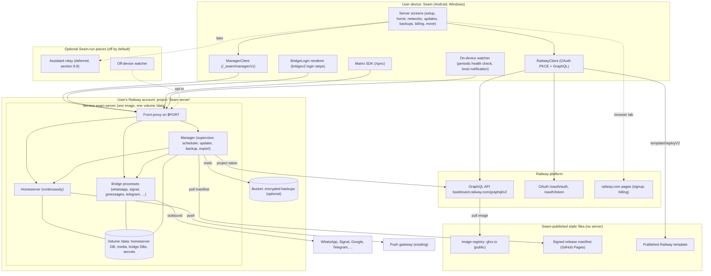
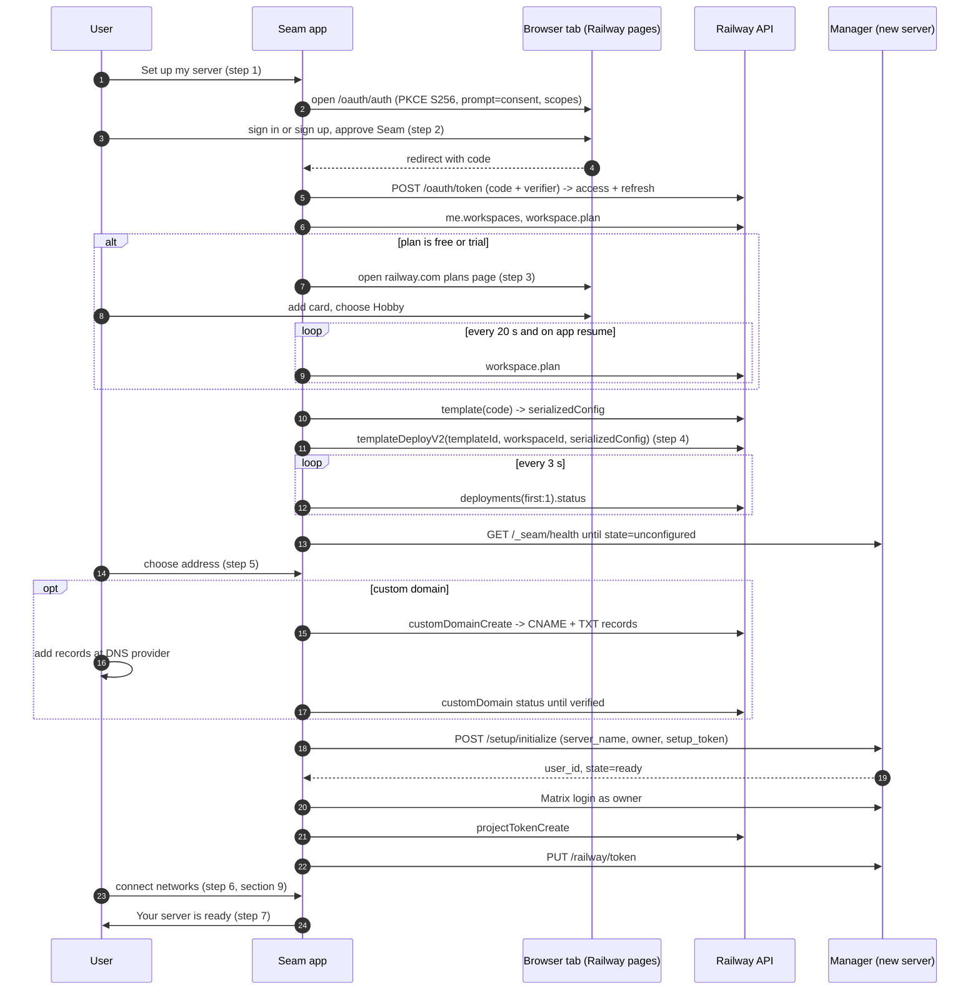
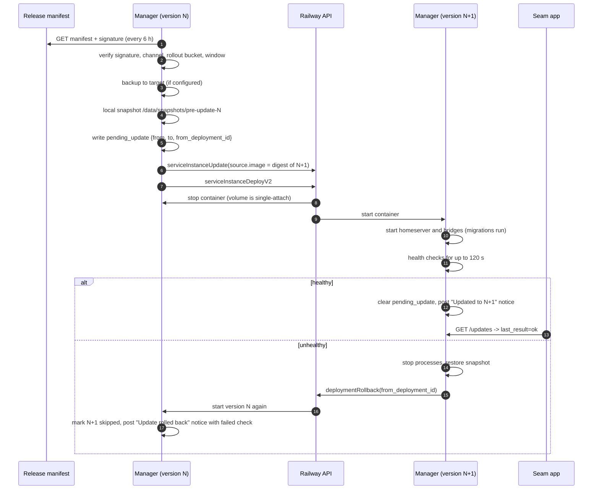
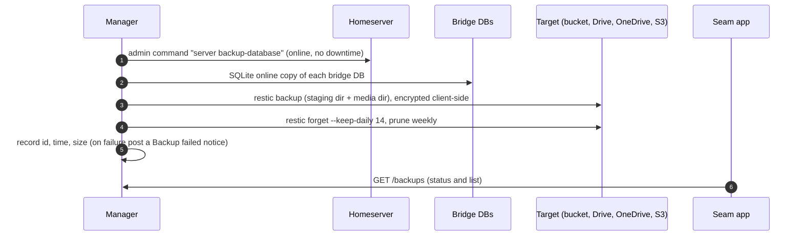
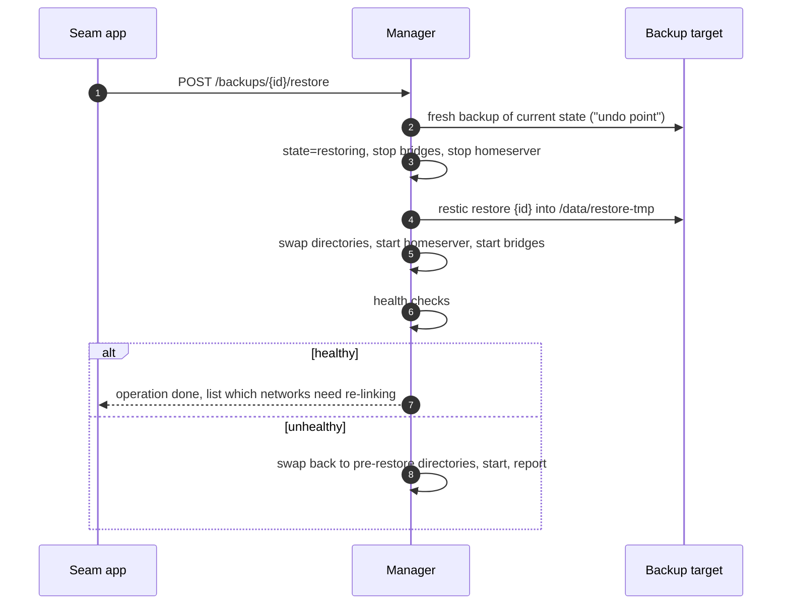
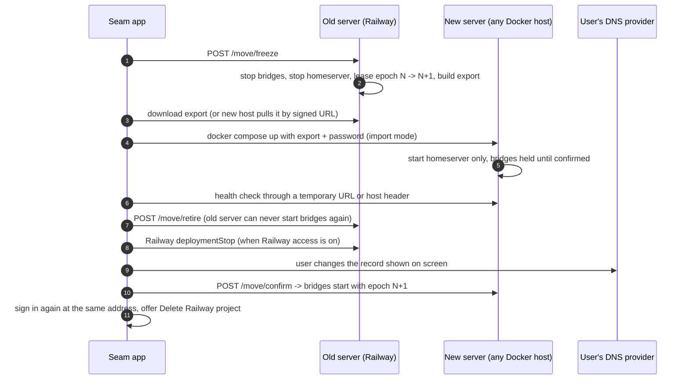
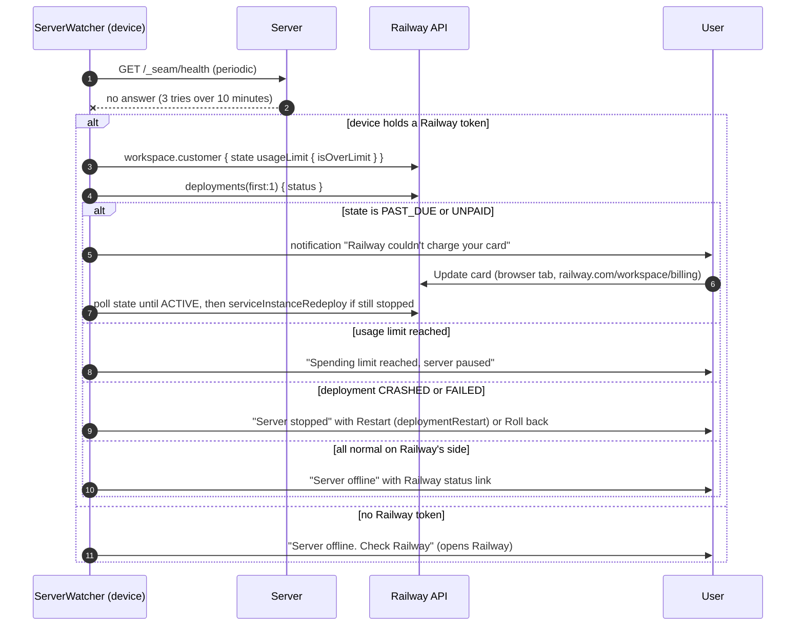
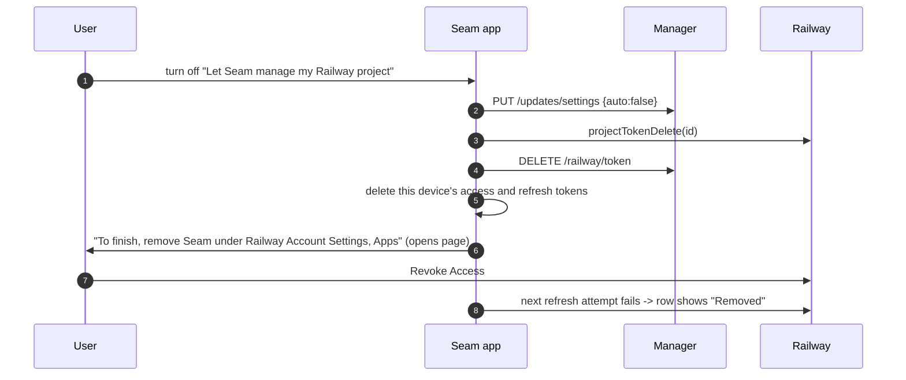

# Seam hosted servers: architecture

Status: design, written 2026-11-26. Nothing is built, deployed or registered. This document is the
build brief: agents work from it without asking Grayson. Where it says UNVERIFIED, the fact was not
confirmed and the named check must run before code depends on it (list in section 16).

Section map against the brief's numbered list: 1 overview (1); 2 components (2); 3 homeserver
(3); 4 flows (5, with interfaces in 4); 5 updates (6); 6 backups (7); 7 export/move (8); 8
security (10); 9 pricing (11); 10 scaling (12); 11 profit (13); 12 timings (14); 13 work
breakdown (15); 14 open decisions and UNVERIFIED list (16). Section 9 is the added "Bridge
sign-in and support without per-bridge UI"; the AI assistant is deferred (section 9.8) and its
cost appears only as an optional later line (sections 12 and 13.5).

Conventions:

- "Seam" is the app (FluffyChat fork, AGPL-3.0, worktrees under `C:\src\fluffychat-*`).
- "Server" is one user's Railway project created by Seam.
- "Manager" is the small API that runs inside the user's server.
- Sources are cited as `[Rn]` and listed in section 17 with URL and fetch date.
- Money is USD. Sizing and timing numbers are estimates until milestone M0 measures them; each
  estimate shows its arithmetic so it can be redone with measured inputs.

Inputs read: `docs/hosted-servers.md`, `docs/embedded-bridges.md`, `docs/merged-contacts.md`,
`lib/utils/bridge_provisioning.dart`, `lib/utils/new_chat/`, `lib/utils/car_app_bridge.dart` (all in
`C:\src\fluffychat-search`), and the two mockups `server-setup-flow.html` and
`server-lifecycle.html`. The lifecycle touchpoint table is treated as the requirements list
(section 5.1 maps every row).

---

## 1. Overview, goals, non-goals

A Seam user who cannot self-host taps "Set up my server" and about five minutes later has a
private Matrix homeserver with messaging bridges, running in **their own Railway account**, paid
by them to Railway. Seam sets it up, keeps it updated, backs it up, explains its cost, and can
export it whole so the user can leave Railway (or Seam) at any time.

### Goals

1. Setup with two visits to Railway's own pages (sign in/approve, add card/choose Hobby). Everything
   else is native Seam UI.
2. No Seam-run server in the required path. Message content, bridge sessions, Railway tokens and
   backup passwords never touch infrastructure Grayson operates.
3. The server maintains itself: updates, rollback, backups and bridge health work while the phone
   is asleep.
4. Host portability: one encrypted export runs the same server with `docker compose` anywhere.
5. One generic bridge sign-in UI for every mautrix bridgev2 bridge, plus a console and shared
   recipes for command-based bridges, so adding a bridge is a server release, not app work
   (section 9).
6. Income from Railway template kickbacks, with no second payment from the user (sections 11, 13).

### Non-goals

- iMessage (needs Apple hardware; stays on the separate macoun setup).
- Seam operating servers for users, reselling compute, or holding user credentials.
- Multi-tenant or public homeservers. Target is one person or one family (up to about 5 accounts).
- Moving an existing Matrix account from another homeserver (Matrix cannot do this).
- High availability. One replica, one volume, short downtime during updates.

### Decisions carried in (not reopened) and the risk each carries

| Decision | Risk to design around |
|---|---|
| Host is Railway, in the user's account | Railway outages and policy changes (section 10.6); export/move is the mitigation |
| Income is the template kickback (15%, 25% with support) [R1] | Railway can change terms; whether plan-included usage earns kickback is UNVERIFIED (section 11.4) |
| Login with Railway (OAuth 2.0 + OIDC, PKCE S256) [R3][R4] | Scope needed to create a project is workspace-wide (section 10.2); no revocation endpoint is published (section 10.2) |
| User must be on Hobby ($5/month incl. $5 usage) [R6][R7] | Free plan sleeps services and caps RAM at 0.5 GB; Limited Trial restricts outbound network [R8] |
| Signup and card entry on Railway's pages in an in-app browser sheet | Must be a system browser tab, not an embedded WebView (section 5.2 note) |
| All bridges in one service on the user's server, toggled from Seam without Railway access | Confirmed and extended: section 2.2 |
| Seam keeps a revocable Railway connection; with it off the server runs but is not updated from Seam | Confirmed as default; both modes designed (section 5.9) |

One conflict between the two mockups: the last step of `server-setup-flow.html` says "Seam no
longer has access to your Railway account", while `server-lifecycle.html` assumes access is kept.
The lifecycle mockup wins (it matches the decision above). Setup step 7 must be redrawn as "Your
server is ready" with a row "Seam's Railway access: On (change)".

---

## 2. Component architecture

### 2.1 Diagram



### 2.2 The Railway template: one service, not five

The brief lists homeserver, Postgres, bridge service, manager, backup job and media store as
template services. The recommended shape folds them into **one service built from one image**:

| Brief item | Where it lives | Why |
|---|---|---|
| Homeserver | process in `seam-server` | continuwuity embeds RocksDB, so it needs no database service (section 3) |
| Postgres | not deployed | bridges use SQLite at this scale; saves about 120 to 250 MB RAM, which is $1.20 to $2.50 per month at $10 per GB [R6] |
| Bridge service | processes in `seam-server`, supervised by the manager | "all bridges in one service" holds; the service also contains the homeserver |
| Manager API | PID 1 of `seam-server` | it supervises, proxies, schedules, updates |
| Backup job | manager scheduler (no separate cron service) | Railway cron needs a separate service that cannot mount the same volume: "Each service can only have a single volume" and a volume belongs to one service [R10] |
| Media store | `/data/media` on the volume | continuwuity object-storage support is UNVERIFIED; Hobby volume limit is 5 GB [R7], managed by retention (section 5.8) |
| Backups target | Railway bucket in the same project (optional) and/or user storage | section 7 |

Reasons for one service:

1. **Atomic versions.** One image tag (`seam-server:1.9.0`) pins the homeserver, every bridge and
   the manager. An update is one deploy; a rollback is one rollback plus one data restore.
2. **One volume.** Pre-update snapshot, backup, export and restore all read one directory tree.
3. **Address gating.** The Matrix server name must be fixed before the homeserver first starts,
   but the mockup asks for the address after deploy begins. With the manager as supervisor the
   container deploys "unconfigured", and the homeserver starts only when Seam posts the chosen name
   (section 5.2).
4. **Cost.** Railway bills usage, not service count, so merging costs nothing and removes Postgres.

Costs of one service: a crash loop in one bridge cannot take the others down (the manager restarts
processes individually), but a container-level failure takes everything down; a bridge-only update
still restarts the homeserver (about a minute). Both are acceptable for a personal server.

Alternative kept open (decision D2): two services, `homeserver` and `bridges+manager`, or the
Synapse + Postgres profile (section 3). The manager API, Seam screens and export format are the
same in every profile; only the image layout and template change.

**Image contents** (`ghcr.io/<org>/seam-server:<semver>`, also referenced by digest):

| Path | Content |
|---|---|
| `/usr/local/bin/seam-manager` | Go binary: supervisor, reverse proxy, API, scheduler |
| `/usr/local/bin/continuwuity` | upstream release binary, version pinned by checksum |
| `/usr/local/bin/mautrix-{whatsapp,signal,gmessages,telegram,meta,slack,linkedin,twitter,...}` | upstream release binaries, pinned by checksum |
| `/usr/local/bin/restic`, `age` | backup and export crypto |
| `/etc/seam/bridges/*.tmpl.yaml` | config template per bridge |
| `/etc/seam/release.json` | versions of everything in the image |

**Volume layout** (`/data`):

```
/data/homeserver/db/            RocksDB
/data/homeserver/media/         media files
/data/bridges/<name>/db.sqlite  per-bridge database (sessions, portals)
/data/bridges/<name>/config.yaml, registration.yaml
/data/manager/state.json        setup state, enabled bridges, schedules, lease epoch
/data/manager/secrets.json      project token, restic password, storage OAuth tokens (file mode 0600, encrypted with MANAGER_KEY variable)
/data/snapshots/pre-update-<version>/   local rollback copy (section 6.4)
```

**Front proxy routes** (manager listens on Railway's `$PORT`; Railway terminates TLS):

| Path | Target |
|---|---|
| `/_matrix/client/unstable/net.graysons.bridge/{name}/{v3,v4}/*` | bridge `{name}` provisioning API `/_matrix/provision/{v3,v4}/*` |
| `/_matrix/*` (rest) | continuwuity |
| `/.well-known/matrix/client`, `/server`, `/mautrix` | generated by manager |
| `/_seam/manager/v1/*` | manager API (section 4) |
| `/_seam/health` | unauthenticated liveness: `{"ok":true,"version":"1.9.0","state":"ready"}` |

The bridge route is exactly the one Seam already calls
(`lib/utils/bridge_provisioning.dart`, path `_matrix/client/unstable/net.graysons.bridge/{name}/v3`),
so New Chat, contact lookup, group creation and merged contacts work against a hosted server with
no change. The proxy adds `v4` because bridge login copy moved to v4 endpoints [R20].

**Template definition** (published to the Railway marketplace, required for kickbacks [R1]):

- Service `seam-server`: source image `ghcr.io/<org>/seam-server:<version>`, volume at `/data`,
  healthcheck path `/_seam/health` (timeout 300 s default [R13]), restart policy on failure,
  1 replica, public networking with a generated Railway domain.
- Variables: `MANAGER_KEY` (template secret generator, 32 bytes), `SEAM_SETUP_TOKEN` (generated,
  single use, section 5.2), `SEAM_SERVER=1` (marker used to find the project again, section 5.3),
  `SEAM_CHANNEL=stable`, `RAILWAY_RUN_UID=0` only if the image needs it
  for the volume [R10].
- Optional bucket `seam-backups`. Whether a template can contain a bucket and whether Hobby can
  create buckets is UNVERIFIED (U9); if not, the manager skips the bucket target.

### 2.3 Seam client modules (new code in the app)

| Module | Suggested path | Responsibility |
|---|---|---|
| `RailwayAuth` | `lib/utils/hosted_server/railway_auth.dart` | OAuth authorization code + PKCE, token storage per device, refresh with rotation |
| `RailwayApi` | `lib/utils/hosted_server/railway_api.dart` | typed GraphQL calls listed in section 4.3 |
| `ServerManagerApi` | `lib/utils/hosted_server/manager_api.dart` | typed client for section 4.1 |
| `ServerSetupController` | `lib/pages/hosted_server/setup/` | the 7-step flow as a resumable state machine |
| `ServerHome` and sub-pages | `lib/pages/hosted_server/` | home, networks, updates, backups, billing, storage, move, access, delete |
| `BridgeLogin` | `lib/utils/bridge_login/` and `lib/pages/bridge_login/` | generic bridgev2 login step renderer (section 9) |
| `ServerWatcher` | `lib/utils/hosted_server/watcher.dart` | periodic health check and local notifications |
| extension of `BridgeProvisioning` | `lib/utils/bridge_provisioning.dart` | add `v4` paths, login, logout, per-login state |

### 2.4 Seam-run and Seam-published pieces

The base design has **no Seam-run server**. Each item below says why it is not on the user's
server, its cost and its liability.

| Piece | Kind | Why not on the user's server | Cost | Liability |
|---|---|---|---|---|
| OAuth client registration ("Seam" app in a Railway workspace) | config, no server | Railway issues client IDs per developer workspace [R4] | $0 | Client ID is public; a native client has no secret [R4]. Grayson's Railway workspace is the publisher of record |
| Railway template | published config | must be in the marketplace to earn kickbacks [R1] | $0 | Template queue support duty; removal if Railway judges it against fair use [R2][R16] |
| Image registry | static, hosted by GitHub (ghcr.io public package) | images must exist before a server does | $0 for public packages (UNVERIFIED at 10,000-user pull volume, U14) | Supply chain: a bad image reaches every server. Mitigated by digests, signatures, canary (section 6) |
| Release manifest | static JSON + signature on GitHub Pages | all servers must agree on "current version" | $0 | Same as registry; signing key custody is Grayson's |
| Update scheduler | **runs in the user's manager** | not needed elsewhere: the manager holds a Railway project token and updates its own service | $0 | none on Seam's side |
| "Server offline" watcher | **on the device by default** (`ServerWatcher`) | a server cannot report its own death | $0 | none. Detection can lag while the phone dozes (section 5.11) |
| Off-device watcher (optional, phase 3) | Seam-run (Cloudflare Worker cron) | catches outages while the phone is off or dozing | about $0 to $28 per month at 100 to 10,000 users (section 12) | Holds server hostnames and push endpoints: a list of who uses Seam servers. Opt-in only |
| Assistant relay (deferred, not in v1; section 9.8) | Seam-run (stateless worker) | an LLM API key cannot ship inside the app or the public image | token cost about $0.25 per assisted conversation (section 9.8) | Sees assistant conversation text (bridge help output, error text). Never sees credentials by construction |
| Push gateway | existing third party | Seam's default pusher posts to `https://push.fluffychat.im/_matrix/push/v1/notify` (`lib/config/setting_keys.dart`) | $0 today | Dependency Grayson does not control; whether the fork's app ID is served by that gateway is UNVERIFIED (U20). UnifiedPush works without it |
| Support (template queue, issues) | Grayson's time | n/a | section 13 | The main real cost |

Unavoidable Seam-side pieces: the OAuth registration, the template, the registry and the manifest.
All four are static. Nothing unavoidable processes user data.

---

## 3. Homeserver choice

### 3.1 What Seam needs from the homeserver

Checked in `C:\src\fluffychat-search` on 2026-11-26:

- **Sync:** classic `/sync` through `matrix` Dart SDK `^16.0.4` (`pubspec.yaml`). Seam does **not**
  use sliding sync (the only hit is a display field in `public_homeserver_data.dart`). Sliding sync
  support is therefore not a requirement.
- **Appservices** for the bridges, including appservice ping and double puppeting.
- **Server-side search:** `POST /_matrix/client/v3/search`
  (`lib/utils/message_search/server_message_search.dart`, `room.searchEvents`).
- **`timestamp_to_event`** for merged-contact jumps (`merged_timeline.dart`, `getEventByTimestamp`).
- **Space hierarchy** (`space_view.dart`), threads and relations, read receipts including private
  receipts, typing, account data (`im.fluffychat.merged_contacts`), pushers (HTTP pusher,
  `event_id_only`), E2EE (vodozemac), authenticated media.
- **Optional:** delayed events MSC4140 (`scheduled_messages.dart`, feature-detected), MatrixRTC
  MSC4143 (calls; out of scope for v1).

### 3.2 Candidates

| | Synapse (+ Postgres) | continuwuity | tuwunel | Dendrite |
|---|---|---|---|---|
| Language, storage | Python, Postgres | Rust, embedded RocksDB [R18] | Rust, embedded RocksDB [R19] | Go, Postgres/SQLite |
| Maintenance | Element, reference server | community fork of conduwuit, active [R18] | "official successor to conduwuit", Swiss government sponsored [R19] | maintenance mode (UNVERIFIED, U21) |
| mautrix bridge compatibility | reference target; bridge docs name only Synapse [R22] | appservices via `!admin appservices register` or startup `admin_execute` [R18]; compatibility with every bridge UNVERIFIED (U6) | appservices supported; same caveat | known gaps historically |
| Search, `timestamp_to_event`, threads | yes | UNVERIFIED (U6); M0 runs Seam's test list against it | UNVERIFIED | partial |
| Admin automation | HTTP admin API | admin room commands and `admin_execute` config, e.g. `users create`, `users reset-password`, `media delete-past-remote-media`, `server backup-database` [R18] | similar lineage | HTTP admin API |
| Online backup | `pg_dump` | built in (`database_backup_path`, RocksDB backup engine) [R18] | similar | `pg_dump` |
| RAM idle, single user (estimate) | Synapse 350 MB + Postgres 120 MB. Published figures range from 350 MB to 1 GB for the pair [R23] | 120 MB (Conduit family is reported at 70 to 100 MB idle [R23]; UNVERIFIED for continuwuity, U5) | similar | 150 MB + DB |
| RAM typical with 4 bridges of traffic (estimate) | 700 MB + 250 MB | 250 MB | similar | 300 MB + DB |
| Migration path off it | to anything Synapse-compatible | conduwuit-family databases migrate in place to tuwunel [R19]; **no path to Synapse** | no path to Synapse yet [R19] | none |
| License | AGPL-3.0 | Apache-2.0 | Apache-2.0 [R19] | AGPL/Apache |

### 3.3 Bridge processes

mautrix bridges are separate Go binaries (one per network), each with its own database; SQLite is
supported. No published idle-memory figures were found [R23]. Estimates used for sizing: 60 MB idle
and 100 MB typical per bridge process with one login; about 20 to 40 MB more per extra login
(family case). UNVERIFIED (U5): M0 measures real RSS.

### 3.4 Recommendation

**continuwuity, with bridges on SQLite, federation off by default.**

1. **Cost decides.** Railway charges $10 per GB-month of RAM [R6]. The Synapse profile is about
   0.7 GB more RAM in the typical case, which is about $7 per user per month for nothing the user
   can see. It would roughly double the user's bill (section 11).
2. **No database service.** One process, one data directory, built-in online backup. Fewer moving
   parts for a manager to supervise and for an export to capture.
3. **Seam does not need sliding sync,** which removes the main reason people pick Synapse today.
4. **Admin commands cover the lifecycle table:** create users, reset password, delete old media,
   online backup, appservice registration without restart [R18].

Costs accepted with this choice, and their mitigations:

- Compatibility is less proven than Synapse. M0 task T0.5 runs the bridge set and Seam's feature
  list against continuwuity before anything else is built on it. If search or `timestamp_to_event`
  is missing, Seam already degrades (client-side search exists; merged jump falls back to live), or
  the project switches to the Synapse profile.
- The database cannot be converted to Synapse (same warning as `docs/embedded-bridges.md`). The
  export therefore promises "same software elsewhere", not "any homeserver".
- A smaller project can stall. tuwunel is a drop-in fallback because conduwuit-family databases
  migrate in place [R19]. The image build keeps the homeserver binary swappable.

Federation off by default (`allow_federation = false` [R18]): bridges do not need it, it removes
most background RAM and CPU and most abuse surface. It can be switched on later without changing
the server name. Registration is closed; accounts are created by the manager (`users create`).

**Resource budget used in the rest of the document** (profile L, recommended):

| Component | RAM idle | RAM typical (1 user) | RAM typical (family of 5, 15 bridge logins) |
|---|---|---|---|
| continuwuity | 120 MB | 250 MB | 400 MB |
| 4 bridge processes | 240 MB | 400 MB | 800 MB |
| manager + proxy | 30 MB | 40 MB | 40 MB |
| **Total** | **390 MB** | **690 MB** | **1,240 MB** |
| CPU average | 0.03 vCPU | 0.08 vCPU | 0.20 vCPU |
| Volume used | 1 GB | 3 GB | 5 GB (Hobby cap) |
| Egress per month | 1 GB | 3 GB | 10 GB |

Profile S (Synapse + Postgres, for comparison): 740 MB idle, 1,390 MB typical, 0.05 / 0.12 vCPU.

---

## 4. Interfaces

### 4.1 Manager API (`/_seam/manager/v1`)

Auth: `Authorization: Bearer <Matrix access token>`. The manager calls the local homeserver
`/_matrix/client/v3/account/whoami` and accepts the request if the user is in the manager's
`owners` list (first account created at setup; more can be added). Two exceptions use a one-time
token from a Railway variable: `POST /setup/initialize` (`SEAM_SETUP_TOKEN`) and
`POST /recover/admin` (`SEAM_RECOVERY_TOKEN`). All responses are JSON; errors are
`{"errcode":"SEAM_...","error":"plain sentence","retryable":bool}`.

| Method and path | Purpose |
|---|---|
| `GET /status` | state (`unconfigured`, `initializing`, `ready`, `updating`, `restoring`, `moving`, `retired`), version, server name, uptime, last backup, storage summary, per-bridge summary, Railway access mode |
| `POST /setup/restore` | body `{target, target_credentials, password, snapshot_id, setup_token}`; used instead of `initialize` to rebuild a lost server from a backup (section 5.7) or to adopt an export (section 8.2) |
| `POST /setup/initialize` | body `{server_name, public_base_url, owner_localpart, owner_password, setup_token, federation:false}`; writes homeserver config, starts it, creates the owner, returns `{user_id}` |
| `GET /bridges` | catalog from the image plus state: `{name, display_name, tier:"supported"|"experimental", login:"bridgev2"|"commands", bridge_bot, guide, recipe, enabled, process:"running"|"stopped"|"crashed", logins:[{id, remote_name, state_event, error, since}]}` |
| `PUT /bridges/{name}` | `{enabled:true|false}`; enabling renders config, registers the appservice, starts the process |
| `POST /bridges/{name}/restart` | one-tap fix |
| `DELETE /bridges/{name}/logins/{login_id}` | `{keep_rooms:bool}`; calls bridge `POST /v3/logout/{loginID}` [R20], then optionally cleans portals |
| `GET /bridges/{name}/logs?lines=200` | redacted tail for "Send details to Seam" |
| `GET /updates` | installed, available, changelog (plain items), channel, rollout eligibility, last result |
| `PUT /updates/settings` | `{auto:bool, window:{start:"02:00", end:"05:00", tz:"America/New_York"}, security_immediate:bool}` |
| `POST /updates/apply` | `{version}`; returns operation id |
| `POST /updates/rollback` | manual rollback to the previous version and snapshot |
| `GET /operations/{id}` | step list with states, for progress screens (update, backup, restore, export) |
| `GET /backups` | targets, schedule, retention, list `{id, time, size_bytes, target}`, last error |
| `PUT /backups/settings` | `{schedule:"daily", keep_days:14, target:"bucket"|"gdrive"|"onedrive"|"s3"|"none"}` |
| `POST /backups/password` | `{password}`; initializes the restic repository; stored encrypted in `secrets.json` |
| `POST /backups/run` | back up now |
| `POST /backups/{id}/download-link` | short-lived signed URL to stream one backup to the device |
| `POST /backups/{id}/restore` | takes a fresh backup first, then restores; operation id |
| `POST /storage-auth/{provider}/start`, `/complete` | OAuth for Google Drive or OneDrive, tokens stay on the server (phase 2) |
| `POST /export` | `{password}` (defaults to backup password); builds the export archive; operation id; `GET /export/{id}/download` streams it |
| `POST /move/freeze` | stops bridges and homeserver, bumps the lease epoch, builds the final export |
| `POST /move/unfreeze` | undo a freeze on a server that is not retired |
| `POST /move/retire` | marks this server retired: bridges can never start here again |
| `POST /move/confirm` | on the new host: accept the higher lease epoch and start bridges |
| `GET /metrics` | per-process RSS, CPU seconds, volume bytes (owners only; used by section 14.5) |
| `GET /storage` | used and limit, by category (media, messages, other) |
| `PUT /storage/retention` | `{media_keep_days:365}` |
| `POST /storage/purge` | `{older_than_days}`; runs `media delete-past-remote-media` (with the local-media flag, since bridged media is local to this server) [R18] |
| `GET /users`, `POST /users`, `DELETE /users/{id}`, `POST /users/{id}/reset-password` | family accounts |
| `GET /railway` | whether a project token is present and valid, auto-update readiness |
| `PUT /railway/token` | `{project_token, project_id, environment_id, service_id}` from the app after setup |
| `DELETE /railway/token` | access off: forget the token |
| `POST /recover/admin` | `{recovery_token, new_password}` |
| `POST /assistant/session` (later, section 9.8) | returns a short-lived token for the relay and the command allowlist for one bridge |
| `GET /assistant/verify?token=` (later, section 9.8) | unauthenticated; tells the relay whether this server issued that token |

### 4.2 Bridge provisioning API (existing, proxied)

mautrix bridgev2 provisioning [R20], reached through the proxy path Seam already uses:

- Already used by Seam: `GET v3/whoami`, `GET v3/contacts`, `GET v3/resolve_identifier/{id}`,
  `POST v3/create_dm/{id}`, `POST v3/create_group/{type}`, capabilities.
- To add: `GET v4/login/flows`, `POST v4/login/start/{flowID}`,
  `POST v4/login/step/{processID}/{stepID}/{user_input|cookies|display_and_wait|webauthn}`,
  `POST v3/login/cancel/{processID}`, `POST v3/logout/{loginID}`, with fallback to the `v3` forms
  when a bridge answers `M_UNRECOGNIZED` [R20].

Note: no login code exists in any worktree under `C:\src` today (grep for `login/flows`,
`login/start`, `display_and_wait` on 2026-11-26 found nothing), so the generic login renderer is
new work (task T3.1), not reuse.

### 4.3 Railway API calls

Endpoint `https://backboard.railway.com/graphql/v2`, `Authorization: Bearer <token>` [R3]. Names
and arguments below were read from live schema introspection on 2026-11-26 [R12]; which OAuth scope
each one needs is UNVERIFIED (U2) and is the first M0 task.

| Purpose | Operation (arguments abbreviated) | Caller |
|---|---|---|
| Who am I, workspaces | `me { workspaces { id name } }` (needs `email profile` with a workspace scope [R5]) | app |
| Plan and billing state | `workspace(workspaceId) { plan customer { state isTrialing currentUsage usageLimit { hardLimit softLimit isOverLimit } } }`; `state` is one of `ACTIVE, CANCELLED, INACTIVE, PAST_DUE, UNPAID` | app |
| Template lookup | `template(code)` returns id and `serializedConfig` | app |
| Deploy | `templateDeployV2(input:{templateId, workspaceId, serializedConfig})` returns `{projectId, workflowId}` | app |
| Poll deploy | `project(id) { services environments }`, `deployments(input:{projectId, serviceId, environmentId}, first:1) { status }`; statuses `BUILDING, DEPLOYING, SUCCESS, FAILED, CRASHED, REMOVED, SLEEPING, SKIPPED, WAITING, QUEUED` [R11] | app |
| Domain | `serviceDomainAvailable(domain)`, `serviceDomainCreate/Update`, `customDomainAvailable(domain)`, `customDomainCreate(input)`, `customDomain(id, projectId)` for DNS record status | app |
| Variables | `variableUpsert(input:{projectId, environmentId, serviceId, name, value, skipDeploys})` [R11] | app |
| Project token for the manager | `projectTokenCreate(input)`, `projectTokenDelete(id)` | app |
| Change image | `serviceInstanceUpdate(serviceId, environmentId, input:{source:{image}})` then `serviceInstanceDeployV2(serviceId, environmentId)` | manager (project token) or app |
| Rollback, restart, stop | `deploymentRollback(id)` (only when `canRollback`), `deploymentRestart(id)`, `deploymentStop(id)`, `serviceInstanceRedeploy` [R11] | manager or app |
| Volume backups (if on Hobby, U8) | `volumeInstanceBackupCreate(volumeInstanceId, name)`, `volumeInstanceBackupList`, `volumeInstanceBackupRestore`, `volumeInstanceBackupScheduleUpdate(kinds)` [R11] | manager or app |
| Usage and cost | `estimatedUsage(projectId, measurements)`, `usage(projectId, measurements, groupBy, startDate, endDate)`; measurements `CPU_USAGE, MEMORY_USAGE_GB, DISK_USAGE_GB, NETWORK_TX_GB, BACKUP_USAGE_GB` | app |
| Spending limit | `usageLimitSet(input)`, `usageLimitRemove(input)`; minimum hard limit is $10 and it is per workspace, not per project [R9] | app |
| Native auto-update fallback | `serviceInstanceAutoUpdateScheduleUpdate(serviceId, environmentId, schedule)` | app |
| Delete | `projectDelete(id)` | app |
| Find an existing server | `externalWorkspaces { projects { id name } }` (project scopes) [R5] | app |

Rate limits: 1,000 requests per hour and 10 per second on Hobby, 100 per hour on Free [R3]. These
are per user token, so nothing aggregates on Seam's side. Setup polling at one request per 3 s for
3 minutes is 60 requests; a new user still on Free or Trial (100 per hour) must not be polled
faster than that.

`templateDeployV2` has open community reports of HTTP 400 "Problem processing request" when
`serializedConfig` is partial; one report says a complete explicit config is required [R15]. The
app therefore fetches the template's own `serializedConfig`, substitutes only the generated
variable values, and sends the whole object. Fallback if the mutation is unusable: build the
project from primitives (`projectCreate`, `serviceCreate` with image source, `volumeCreate`,
`variableUpsert`, `serviceDomainCreate`). The fallback probably forfeits kickback attribution
(UNVERIFIED, U11), so it is a last resort and M0 must prove the template path.

---

## 5. Flows

### 5.1 Lifecycle touchpoint table mapped to components and APIs

Every row of the table in `server-lifecycle.html`. "Mgr" is the manager API (section 4.1), "Rwy"
is the Railway API (section 4.3), "Prov" is the bridge provisioning API (section 4.2).

| # | Area | Moment | Components | Calls | Section |
|---|---|---|---|---|---|
| 1 | Setup | Offer, sign-in, plan, deploy, address, networks, done | `ServerSetupController`, `RailwayAuth`, `RailwayApi`, manager | OAuth; Rwy `workspace`, `templateDeployV2`, `deployments`, domain calls, `projectTokenCreate`; Mgr `setup/initialize`, `railway/token`, `bridges` | 5.2 |
| 2 | Setup | Deploy failed: what failed, Retry, undo | setup controller | Rwy `deployments.status`, `deploymentLogs`, `serviceInstanceRedeploy`, `projectDelete` | 5.2 errors |
| 3 | Setup | Railway account not verified, bridges cannot reach the internet | setup controller, manager connectivity probe | Rwy `workspace.plan`; Mgr `status.outbound_ok` | 5.2 errors |
| 4 | Setup | Already have a server: connect it | setup controller | OAuth with a project scope; Rwy `externalWorkspaces`, `variables` (marker `SEAM_SERVER=1`), service domain; then normal Matrix login | 5.3 |
| 5 | Home | Status, version, last backup, month cost | `ServerHome` | Mgr `status`; Rwy `estimatedUsage`, `usage` | 5.4 |
| 6 | Networks | Add a network | `BridgeLogin`, manager | Mgr `PUT bridges/{name}`; Prov `login/flows`, `login/start`, `login/step` | 9 |
| 7 | Networks | Re-link a dropped network | `BridgeLogin`, server notices | Mgr `bridges` (state `BAD_CREDENTIALS`); Prov `login/start?login_id=` | 9.4 |
| 8 | Networks | Disconnect, keep or delete chats | networks page | Mgr `DELETE bridges/{name}/logins/{id}` with `keep_rooms` | 9.4 |
| 9 | Updates | Update available, what's new, update now | updates page, manager updater | Mgr `updates`, `updates/apply`, `operations/{id}` | 6 |
| 10 | Updates | Auto-update on/off, overnight window | updates page, manager scheduler | Mgr `updates/settings`; needs Mgr `railway` token present | 6.3 |
| 11 | Updates | In progress, then health check | manager updater | manager: Rwy `serviceInstanceUpdate`, `serviceInstanceDeployV2`; Mgr `operations/{id}` | 5.5 |
| 12 | Updates | Failed and rolled back | manager updater, server notices | manager: snapshot restore, Rwy `deploymentRollback` | 5.5, 6.4 |
| 13 | Updates | Security update applied with auto-updates off | manager scheduler | manifest `security:true`; setting `security_immediate` | 6.3 |
| 14 | Backups | Daily automatic backup, status | manager backup job | restic to target; Mgr `backups` | 5.6, 7 |
| 15 | Backups | Back up now, download a copy | backups page | Mgr `backups/run`, `backups/{id}/download-link` | 7 |
| 16 | Backups | Restore from a backup | backups page, manager | Mgr `backups/{id}/restore`; dead-server case adds Rwy redeploy and Mgr `setup/restore` | 5.7 |
| 17 | Backups | Backup password, set once | backups page | Mgr `backups/password`; offered to the OS password manager | 7.2 |
| 18 | Move | Export everything to self-host | move page, manager export | Mgr `export`, `export/{id}/download` | 8 |
| 19 | Move | Move to another host, switch the address | move page | Mgr `move/freeze`, `move/retire`; Rwy `deploymentStop`; DNS at the user's provider | 5.8 |
| 20 | Billing | This month's cost and estimate | billing page | Rwy `usage`, `estimatedUsage` (grouped by measurement) | 5.4 |
| 21 | Billing | Spending limit | billing page | Rwy `workspace.customer.usageLimit`, `usageLimitSet`; minimum hard limit $10, workspace-wide [R9] | 5.4 |
| 22 | Billing | Change card, invoices, plan | browser tab | `https://railway.com/workspace/billing` [R7] | 5.4 |
| 23 | Billing | Payment failed, server stopped | watcher, home | Rwy `workspace.customer.state` (`PAST_DUE`, `UNPAID`) | 5.10 |
| 24 | Storage | Filling up: clear old media, retention | storage page, manager | Mgr `storage`, `storage/retention`, `storage/purge` | 5.9 |
| 25 | Alerts | Offline, network disconnected, backup failed, rolled back, payment, storage, Railway outage | server notices room (on-server events), `ServerWatcher` (off-server events) | Matrix push; `/_seam/health`; Rwy billing and deployment state | 5.11 |
| 26 | Access | Seam's Railway access on/off | access page | discard device tokens; Mgr `DELETE railway/token`; Rwy `projectTokenDelete`; user revokes at Railway | 5.12 |
| 27 | Access | New phone or Windows | sign-in | normal Matrix login; Mgr `status` shows management screens to owners; optional OAuth on the new device | 5.12 |
| 28 | Access | Lost admin password | recovery flow | Rwy `variableUpsert SEAM_RECOVERY_TOKEN`; Mgr `recover/admin` | 5.13 |
| 29 | Closing | Delete the server | delete page | Mgr `export` first; Rwy `projectDelete` | 5.14 |

These are the 29 rows of the mockup's table, in its order. The seven alert kinds of row 25 are
split by source in section 5.11.

### 5.2 Setup (mockup `server-setup-flow.html`, steps 1 to 7)



Step details:

1. **Offer.** Shown when the signed-in homeserver is not a Seam server, or no account exists. Text
   states the price before anything opens: Railway Hobby $5 per month, typical total from section
   11.
2. **Sign in and approve.** Authorization request to `https://backboard.railway.com/oauth/auth`
   with `response_type=code`, `code_challenge_method=S256`, `prompt=consent`,
   `scope=openid email profile offline_access workspace:member` [R4][R5]. Native apps send no
   client secret [R4]. Redirect URI: Android App Link `https://<seam-domain>/railway/callback`
   (needs a static `assetlinks.json`), Windows loopback `http://127.0.0.1:<port>/callback`.
   Whether Railway accepts custom-scheme or loopback redirect URIs is UNVERIFIED (U3); the docs
   show an HTTPS callback and an HTTP localhost example and require exact string match [R4].
   **The sheet must be a Chrome Custom Tab (Android) or the default browser (Windows), not an
   embedded WebView.** Railway sign-in offers GitHub and Google, and Google refuses sign-in inside
   embedded WebViews; a Custom Tab also shares the user's existing browser sessions.
3. **Plan.** If `workspace.plan` is `free` or `trial`, open the plans page in the same kind of
   tab. Poll `workspace.plan` every 20 s and on resume (Free accounts are limited to 100 API
   requests per hour [R3]). Hobby is required because Free services sleep after 5 to 10 minutes
   without outbound traffic and are capped at 0.5 GB RAM, and a Limited Trial has restricted
   outbound networking [R8].
4. **Create.** `templateDeployV2` with the full `serializedConfig`. The template generates
   `MANAGER_KEY` and `SEAM_SETUP_TOKEN`; the app reads `SEAM_SETUP_TOKEN` with `variables` after
   deploy. Progress rows map to: OAuth done ("Railway account connected"), `projectId` returned
   ("Server created"), deployment `SUCCESS` and `/_seam/health` answering ("Database starting" is
   relabelled "Server starting", since there is no database service), domain ready ("Secure
   address"), bridges enabled ("Bridges").
5. **Address.** Default `<name>.up.railway.app` checked with `serviceDomainAvailable`; or the
   user's own domain. The screen states that the name is permanent and that only a custom domain
   can move hosts. The homeserver is initialized only now, with that name. Custom domain needs a
   CNAME and a TXT record; apex domains need CNAME flattening or ALIAS; certificates are issued
   "within an hour" of DNS being correct and DNS can take up to 72 hours [R14]. The user can leave
   the screen; setup resumes from saved state.
6. **Networks.** `PUT /bridges/{name} {enabled:true}` then the generic login (section 9).
7. **Done.** Shows server, networks connected, and "Seam's Railway access: On".

The setup controller persists its step and IDs (`workspaceId`, `projectId`, `serviceId`,
`environmentId`, domain) locally so a killed app resumes instead of deploying twice. Before
deploying it looks for an existing project marked `SEAM_SERVER=1`.

Error states:

| Failure | Detection | Screen behaviour |
|---|---|---|
| User denies consent | redirect carries `error` [R4] | back to step 1 with "Nothing was created" |
| Still Free or Trial after 5 minutes | plan poll | explain Hobby is required; reopen plans page |
| `templateDeployV2` returns 400 | GraphQL error with `traceId` [R15] | retry once; then offer "Try again later" and show the trace ID for a Railway support thread; do not fall back silently |
| Deployment `FAILED` or `CRASHED` | `deployments.status` | show last 20 lines of `deploymentLogs`, Retry (`serviceInstanceRedeploy`), or "Undo" (`projectDelete`) |
| Outbound network restricted (Limited Trial) | manager probe of three bridge endpoints at boot, reported in `status.outbound_ok` | "Railway is limiting this account's network until it is upgraded"; reopen plans page. Whether upgrading lifts it without a redeploy is UNVERIFIED (U10) |
| Domain taken | `serviceDomainAvailable` false | inline, pick another |
| Custom domain not verified after 1 hour | `customDomain` status | show the two records again with copy buttons; offer the free address instead (only before initialize) |
| `setup/initialize` fails | manager error | Retry; the homeserver has not started, so the name can still change |

### 5.3 Already have a server

OAuth with `openid offline_access project:member` and `prompt=consent`; the user picks the project
on Railway's consent screen [R5]. The app lists `externalWorkspaces.projects`, finds the service
with variable `SEAM_SERVER=1`, reads its domain, and runs a normal Matrix login against it. If the
user is an owner, management screens appear. No deploy happens.

### 5.4 Server home and billing

- Home reads `GET /status` (no Railway access needed) and, when the device holds a Railway token,
  `estimatedUsage(projectId, [CPU_USAGE, MEMORY_USAGE_GB, DISK_USAGE_GB, NETWORK_TX_GB,
  BACKUP_USAGE_GB])` and `usage(...)` for month-to-date. Dollars are computed in the app from the
  unit prices in section 11.1 (a small table in app config, versioned with the manifest so a
  Railway price change does not need an app release).
- The mockup's "Server / Database / Networks" split cannot be measured in a single-service design.
  Show "Memory / Processor / Storage / Network" instead, which is what Railway bills.
- Spending limit: `usageLimitSet`. It is per workspace, has a $10 minimum, and takes all workloads
  offline when hit [R9]; the screen must say all three. Default: suggest $15, do not set one
  silently.
- Card, invoices, plan: open `https://railway.com/workspace/billing` in a browser tab.
- Without Railway access: cost rows show "Turn on Seam's Railway access to see cost" and a link to
  Railway's usage page.

### 5.5 Update with rollback



- Health checks in the new version: homeserver `/_matrix/client/versions` returns 200; owner
  `whoami` works; every enabled bridge process is running and answers appservice ping; no login
  that was `CONNECTED` before is now `BAD_CREDENTIALS` or `UNKNOWN_ERROR` [R20]; free disk above
  10%.
- Downtime is real. Railway does not run two deployments on one volume, "even if there is a
  healthcheck endpoint configured" [R13][R10]. The mockup line "starts the new version beside the
  old one and only switches when it passes" must become "stops, updates, checks; goes back
  automatically if the check fails". Expected downtime 0.5 to 1.5 minutes (section 14).
- If the new image cannot start the manager at all, Railway's deploy healthcheck on
  `/_seam/health` fails (timeout set to 120 s) and the deployment is marked `FAILED`. Whether
  Railway then restarts the previous deployment for a service with a volume is UNVERIFIED (U7).
  If it does not, recovery needs the app: `ServerWatcher` sees the server offline, `RailwayApi`
  sees the latest deployment `FAILED`, calls `deploymentRollback` on the previous one, and the old
  manager restores the snapshot when it finds `pending_update` still set. Canary rollout exists to
  keep such an image away from the stable channel.
- "Update now" from the app is the same path with the window check skipped.
- Mockup copy "Seam has been told" needs a Seam-run endpoint that the base design does not have.
  Change to "Seam will try again when a fix is out", and make "Send details to Seam" open a
  prefilled public issue or email containing the redacted failure report (decision D7).

### 5.6 Backup



### 5.7 Restore



- Dead-server variant (volume lost, project deleted, new host): the app redeploys the template
  (section 5.2 steps 4 and 5 with the **same** server name), then calls `POST /setup/restore`
  `{target, target_credentials, password, snapshot_id}` (authorized by `SEAM_SETUP_TOKEN`) instead
  of `setup/initialize`. Add this endpoint to the manager (it is the import path of section 8 too).
- Honest copy: the mockup says messages after the backup "will sync back in". That depends on each
  bridge's backfill and is best effort. More important, restoring an older bridge database rolls
  back session state; WhatsApp and Signal may then reject the session and need re-linking. The
  restore screen must say "You may need to re-link WhatsApp and Signal afterwards". Task T2.6
  measures which bridges survive a 1-day and a 14-day rollback.

### 5.8 Export and move



Rules:

- Only a custom-domain server keeps its address. A `*.up.railway.app` server can be exported and
  self-hosted, but under a **new** server name, which means new accounts and rooms; the screen
  says so before anything starts.
- Bridges stop on the old server **before** the final export is taken, and the old server is
  retired before the new one starts bridges. A retired manager refuses to start any bridge even if
  Railway restarts the container (flag in `/data/manager/state.json` plus variable
  `SEAM_RETIRED=1` when Railway access is on).
- The mockup's order (new server checked, then DNS, then stop Railway) is kept for the homeserver,
  but its note is the binding rule: network logins run in one place at a time.
- Rollback of a move before `move/confirm`: `POST /move/unfreeze` on the old server while it is
  not retired.

### 5.9 Storage

`GET /storage` reports volume use by category. Retention (`media_keep_days`, default 365) runs
nightly through the homeserver's media deletion command [R18]. Bridged media counts as local
media on this server, so the command needs its local-media flag; original files remain on the
user's phone and on the source network, which is what the mockup text promises. Alerts at 80% and
95% of the volume (server notices, plus Railway's own volume alerts if a webhook or email rule is
set [R17]). The Hobby volume limit is 5 GB [R7]; "increase storage" means upgrading to Pro and is
out of scope for v1.

### 5.10 Payment failed detection



Railway retries a failed charge "over several days", warns, then stops services until open
invoices are paid [R9a]. The exact timeline and whether services restart on their own after
payment are UNVERIFIED (U27); the flow redeploys explicitly if the server is still down five
minutes after the state returns to `ACTIVE`.

### 5.11 Alerts

Two sources, no Seam-run server:

1. **On-server events** (network disconnected, backup failed, update applied or rolled back,
   storage 80% and 95%): the manager posts events into a private "Server" room it creates for the
   owners. They arrive through the normal Matrix push path as ordinary Seam notifications. Seam
   renders them with the one next step from the mockup (event type `net.graysons.seam.notice`
   with `kind`, `severity`, `action`).
2. **Off-server events** (server offline, payment problem, spending at 80% of limit, Railway
   outage): `ServerWatcher` on the device. Android: WorkManager periodic job, minimum interval 15
   minutes, deferred further by Doze; Windows: a timer while Seam runs. It checks
   `/_seam/health` and, when a Railway token is present, billing and deployment state. Local
   notifications only.

Limits to state in the UI: an outage that begins while the phone is in deep sleep is noticed when
the job next runs (typically within 15 to 60 minutes; longer overnight). Railway itself emails the
account owner for payment failures and usage thresholds [R9][R9a], which is the backstop. The
optional off-device watcher (section 2.4) closes the gap for users who opt in.

### 5.12 Access toggle, new devices

Two credentials exist, both scoped by what the user approved:

| Credential | Holder | Used for |
|---|---|---|
| OAuth refresh token (one per device that ran the flow) | device secure storage | setup, billing and cost display, offline diagnosis, dead-server restore, delete |
| Project token | manager `secrets.json` | scheduled updates, rollback, self-restart, Railway volume backups |



- Railway's discovery document lists no revocation endpoint [R12a], so the app cannot revoke its
  own grant (UNVERIFIED that none exists, U4). Until the user revokes at Railway [R4a], other
  devices that ran the flow still hold tokens. The screen must show "Off on this device" versus
  "Removed" truthfully.
- With access off: the server keeps running; networks, backups to non-Railway targets, export and
  storage management still work (they need only the manager). Updates from Seam, Railway volume
  backups, cost display, restart and delete do not. To stay patched without Seam, the access-off
  screen offers "Let Railway keep it updated": Railway's own image auto-update with a maintenance
  window, which works for `ghcr.io` images with semantic version tags [R21]. It has no Seam
  health check or rollback; pre-update volume backups are Pro only [R21].
- Turning access back on: run the OAuth flow again, create a new project token, hand it to the
  manager.
- **New phone or Windows:** sign in with the Matrix account. `GET /status` succeeds for owners, so
  all manager-backed screens work at once. Railway-backed rows (cost, restart) show "Connect
  Railway on this device" and run the OAuth flow with `project:member`. Each authorization can
  hold up to 100 refresh tokens [R4], so several devices are fine; a device must never share its
  refresh token with another, because reuse of a rotated token revokes the whole authorization
  [R4b].

### 5.13 Lost admin password

Needs Railway access on the device (or the user doing one step in Railway's dashboard).

1. App generates a random token, `variableUpsert(name:"SEAM_RECOVERY_TOKEN", value:<token>)`
   (triggers a redeploy, about a minute).
2. App calls `POST /recover/admin {recovery_token, new_password}`; the manager runs
   `users reset-password` for the owner [R18] and ignores the token afterwards.
3. App deletes the variable (`variableDelete`) and signs in.

E2EE note: a password reset does not recover Matrix encryption keys. If the user also lost every
signed-in device and the recovery key, encrypted history is unreadable; bridged rooms are
unaffected when bridge encryption is off (section 10.4).

### 5.14 Delete

1. Require an export from today (`POST /export`, download confirmed) or an explicit "skip".
2. Type the address to confirm.
3. `POST /move/retire` (so a half-deleted project cannot keep bridge sessions alive), then
   `projectDelete(id)`. Billing stops with the project; the plan subscription itself continues
   until the user cancels Hobby at Railway, and the screen links there.
4. Backups in the user's own storage are kept; a bucket inside the project is deleted with it,
   and the screen says which applies.
5. Railway keeps a deleted volume restorable for 48 hours through an emailed link [R10].

---

## 6. Updates

### 6.1 Release pipeline

Lives in the new repository `seam-server` (section 15). Railway's own template update
notifications cannot carry this: they work only for templates based on a GitHub repository, and
"Docker image-based templates cannot be automatically updated through this mechanism" [R29].

1. **Inputs:** `versions.lock` pins each upstream (continuwuity, each mautrix bridge, restic, age)
   by version and SHA-256. A scheduled job opens a pull request when an upstream publishes a
   release. mautrix bridges release together on a monthly cadence (for example v26.08 [R23a]),
   which sets the natural rhythm: one Seam server release per month plus security patches.
2. **Build:** GitHub Actions builds the manager, downloads pinned upstream binaries, verifies
   checksums, assembles the image for `linux/amd64` (add `arm64` for self-hosters), pushes to
   `ghcr.io/<org>/seam-server:<semver>` and records the digest. No compilation of upstreams, so a
   build takes minutes.
3. **Test:** the integration suite (task T1.6) boots the image with docker compose, creates a
   user, registers every bridge, runs the provisioning `login/flows` call on each, runs the
   upgrade path from the previous two releases with a populated data directory, and runs the
   rollback path.
4. **Sign:** cosign keyless signature on the image; the release manifest is signed with an
   Ed25519 key (minisign format) whose public half is compiled into the manager. Grayson holds the
   private key offline or in a hardware token; CI never sees it (decision D8 covers the trade-off
   with fully automated releases).
5. **Publish:** `manifest.json` and `manifest.json.minisig` to GitHub Pages.

Manifest:

```json
{
  "schema": 1,
  "channels": {
    "canary": {"version": "1.9.0", "image": "ghcr.io/ORG/seam-server@sha256:...", "rollout": 100},
    "stable": {"version": "1.8.2", "image": "ghcr.io/ORG/seam-server@sha256:...", "rollout": 100}
  },
  "releases": {
    "1.9.0": {
      "min_from": "1.7.0",
      "security": false,
      "changes": ["Signal: faster photo sending", "Google Messages: fixes missed group photos"],
      "bridges": {"whatsapp": "v26.11", "signal": "v26.11"},
      "published": "2026-12-01T00:00:00Z"
    }
  },
  "blocked": ["1.8.1"],
  "prices": {"ram_gb_month": 10, "vcpu_month": 20, "volume_gb_month": 0.15, "egress_gb": 0.05}
}
```

### 6.2 Staged rollout

- **Canary channel:** Grayson's own server and users who opt in. A release stays on canary at
  least 72 hours.
- **Stable:** promoted with `rollout` 10, then 50, then 100, at least 24 hours apart. A manager is
  eligible when `sha256(server_name) mod 100 < rollout`.
- **Stop button:** adding a version to `blocked` stops new installs at the next manifest poll
  (every 6 hours; at most 6 hours of exposure).
- There is no fleet telemetry in the base design, so promotion is judged from canary servers,
  the integration suite and voluntary reports. Decision D7 offers opt-in anonymous update results.

### 6.3 Auto-update policy

- Default on, window 02:00 to 05:00 in the device's time zone, saved on the server.
- "Security fixes right away" default on: a release with `security:true` installs at the next
  manifest poll regardless of window, and also when auto-update is off, unless the user turns this
  switch off too. This is the policy decision the mockup flags (decision D6).
- Auto-update requires the project token. With Railway access off the settings screen shows the
  mockup's "Needs Seam's Railway access" line and the Railway-native fallback of section 5.12.
- A version that rolled back is skipped; the manager retries only when the manifest offers a
  different version.

### 6.4 Rollback mechanics

- Railway side: `deploymentRollback(id)` on the previous deployment (must have
  `canRollback:true` [R11]); fallback `serviceInstanceUpdate` to the previous digest plus
  `serviceInstanceDeployV2`. How long Railway keeps a deployment rollback-able on Hobby is
  UNVERIFIED (U7).
- Data side: an image rollback alone is unsafe, because bridges and the homeserver migrate their
  databases forward on start and older binaries may refuse a newer schema. Hence the local
  snapshot taken before every update: RocksDB online backup plus SQLite copies in
  `/data/snapshots/pre-update-<version>` (media is not copied; it is append-only). Snapshot size is
  about the database size, 0.2 to 0.5 GB for one user. Kept 7 days.
- If Railway volume backups are available on Hobby (UNVERIFIED, U8), the manager also calls
  `volumeInstanceBackupCreate` before updating. Those backups restore only "into the same project
  + environment" [R10a], so they complement and never replace section 7.
- Messages that arrive during a failed update and are then rolled back are re-fetched by bridges
  only where the network allows it. Keep the health-check deadline short (120 s) to keep that
  window small.

---

## 7. Backups

### 7.1 Where backups live

What Railway offers [R10a][R11][R21]: volume backups, manual or scheduled (daily kept 6 days,
weekly kept 27 days, monthly kept 89 days), incremental, billed like volume storage, restorable
only into the same project and environment, deleted when the volume is wiped, manual backups
limited to 50% of the volume size, with API mutations for create, list, restore, lock, delete and
schedule. The docs do not say which plans include them; the image auto-update page says automatic
pre-update backups are "For Pro plan users". Availability on Hobby is UNVERIFIED (U8).

Railway volume backups cannot satisfy "restore anywhere else", so they are a convenience layer
only. The backup of record is a **restic repository**, encrypted on the server before upload:

| Target | Phase | Notes |
|---|---|---|
| Download to device ("Download a copy") | 1 | always available; the only off-Railway copy in phase 1 |
| Railway bucket in the same project | 1 if buckets work on Hobby (U9) | S3-compatible, $0.015 per GB-month, free egress [R6]; dies with the project or the Railway account |
| Google Drive or OneDrive in the user's account | 2 | OAuth run from Seam, tokens stored on the user's server, restic through its rclone backend; needs Seam-registered OAuth clients at Google and Microsoft (config, not servers); Google's verification requirements for the `drive.file` scope are UNVERIFIED (U25) |
| Any S3-compatible bucket (Backblaze B2, Cloudflare R2, a home NAS) | 2 | user pastes endpoint and keys; fits the "local where possible" preference |

Default in phase 1: bucket if available, plus a monthly prompt to download a copy. Default in
phase 2: the user's Drive or OneDrive, as in the mockup.

### 7.2 Encryption and the backup password

- The user sets one backup password (mockup "Backup password"). It becomes the restic repository
  password and the default export password. Seam offers it to the OS password manager.
- The server must hold the password (encrypted with `MANAGER_KEY` in `secrets.json`) to run
  unattended daily backups. So the password protects backups **at rest in the storage target and
  in transit**, against the storage provider and anyone who obtains the files. It does not protect
  against someone who controls the running server, who can read the live data anyway. The UI line
  "Seam can't recover it" is true: it never leaves the user's device and server.
- Changing the password adds a new restic key and removes the old one; no re-upload.

### 7.3 Retention and size

- Daily at the start of the update window; `forget --keep-daily 14` (mockup "Keep 14 days");
  prune weekly; integrity check monthly on a 5% sample.
- Size: restic deduplicates, so 14 daily snapshots of a mostly append-only data set cost about
  1.2 to 1.5 times the live data. One user with 3 GB (0.5 GB databases, 2.5 GB media): about 4 GB,
  which is $0.06 per month in a Railway bucket. The mockup's 412 MB per day corresponds to a
  lighter user.
- A full volume (5 GB): about 7 GB repository, $0.11 per month in a bucket; free within Google
  Drive's 15 GB or OneDrive's 5 GB only if the user has room (the "Google Drive is full" alert in
  the mockup).

### 7.4 Restore

Section 5.7. Durations in section 14.4.

---

## 8. Export and move format

### 8.1 Archive `seam-export-v1`

One file, `seam-export-<server_name>-<date>.tar.zst.age`: a zstd-compressed tar encrypted with
`age` in passphrase mode (scrypt). Streamed, so it never needs free disk equal to its size.

```
manifest.json                 schema, server_name, seam-server version, image digest, lease_epoch, sha256 of every file
README.md                     step-by-step self-hosting instructions for this exact export
docker-compose.yml            seam-server image by digest + Caddy for TLS
Caddyfile                     reverse proxy for <server_name>, automatic certificates
.env                          MANAGER_KEY, generated secrets, SEAM_IMPORT=1
data/homeserver/db/           RocksDB directory, directly usable (offline copy taken while stopped)
data/homeserver/media/        media files
data/homeserver/signing.key   server signing key (if stored outside the DB by the chosen homeserver)
data/bridges/<name>/db.sqlite bridge sessions, portals, puppets
data/bridges/<name>/config.yaml, registration.yaml
data/manager/state.json       enabled bridges, schedules, owners, lease epoch
```

Contents map to the brief's list: DB dump (homeserver database; for the Synapse profile this
would be `pg_dump` output instead), media, bridge DBs, signing keys, config, docker-compose.
Network logins live in the bridge databases. Not included: Railway tokens, storage OAuth tokens,
the backup repository (the user already owns that separately).

### 8.2 Self-hosting it

Requirements: any Linux host or Windows with Docker Desktop, 2 GB RAM, ports 80 and 443 reachable,
and control of the DNS for the server name.

```
age -d seam-export-...tar.zst.age | zstd -d | tar x
cd seam-export
docker compose up -d
```

The same `seam-server` image runs everywhere; `SEAM_IMPORT=1` makes the manager adopt the data
directory, keep bridges stopped, and wait for `POST /move/confirm`. Outside Railway the manager
has no Railway token, so updates use plain image pulls: the compose file includes an optional
updater profile, and the manager still does snapshot, health check and data rollback. Seam's
server screens keep working against a self-hosted server; Railway-only rows are hidden when
`status.host` is not `railway`. A home computer behind NAT needs a tunnel or port forward, which
the README explains but Seam does not automate in v1.

### 8.3 Cutover procedure

Section 5.8 is the procedure. Invariants an implementation must enforce:

1. The export used for a move is taken after bridges stop (`move/freeze`), never from a running
   server. "Download everything" for safekeeping may be taken live.
2. `lease_epoch` in the export is one higher than the old server's. A manager starts bridges only
   if its stored epoch is the highest it has ever seen and it is not retired.
3. The old server is retired before `move/confirm` is sent to the new one.
4. DNS: lower the record's TTL a day ahead when possible; during propagation some devices reach
   the old address, which now answers `/_seam/health` with `state:"retired"` so Seam can explain.

---

## 9. Bridge sign-in and support without per-bridge UI

Question from Grayson: can Seam avoid maintaining a UI per bridge as bridges are added, and how
does it limit its own support burden? Yes. v1 has three pieces, none of them AI:

1. **Generic bridgev2 sign-in** (sections 9.1 to 9.4): native screens for every bridgev2 bridge.
2. **Layer A, the bridge console** (9.5): a focused view of the bot chat, for bridges that still
   use commands and for anything else.
3. **Layer B, recipes** (9.6): small shared JSON files that turn a legacy bridge's commands into
   buttons. Needed today only for Discord and Google Chat.

An AI assistant that drives the commands (layer C) is deferred; its design notes are in 9.8.

### 9.1 Generic sign-in: one renderer for the bridgev2 login API

mautrix-go `bridgev2` exposes sign-in as a typed step machine over HTTP [R20]. A client calls
`GET /v4/login/flows`, starts one with `POST /v4/login/start/{flowID}`, renders the returned
step, submits it, and repeats until a step of type `complete`. Every text shown to the user (flow
name, instructions, field labels) comes from the bridge. mautrix's own desktop tool,
mautrix-manager, is exactly such a generic client and "All bridges using the new bridgev2
framework in mautrix-go are supported" [R20a]. Seam builds the same thing natively once.

Step types the renderer must implement [R20]:

| Step type | What the bridge sends | Seam widget |
|---|---|---|
| `user_input` | fields with `type` in `username, phone_number, email, password, 2fa_code, token, url, domain, select`, plus label, description, placeholder, default, pattern, min/max length, optional flag, autofill domain; optional attachments (`m.image`, `m.audio`, used for captchas) | native form; keyboard and autofill by field type; password and code fields never logged |
| `display_and_wait` | `type` in `qr, emoji, code, nothing`, data, optional image URL, cancellable flag | QR image, big code, emoji, or a spinner; client long-polls the step endpoint |
| `cookies` | `url` to open, optional `user_agent`, optional `extract_js`, optional hidden-webview flag, and a list of fields each with sources of type `cookie` (name + domain), `local_storage`, `request_header`, `request_body`, `redirect_url` (with URL regex), or `special` (value returned by `extract_js`) | embedded WebView that loads the URL, watches until every required value is present, then submits and closes |
| `webauthn` | relying party URL and options | platform passkey API |
| `client_http` | an HTTP request the client must run and return (only if the client opts in) | not implemented in v1; never opt in |
| `complete` | login id and remote name | success screen, back to Networks |

Errors: any error from a step ends the process; the renderer offers "Try again" from the flow
list. `FI.MAU.BRIDGE.MISSING_CLIENT_CAPABILITY` means the bridge needs a step type Seam did not
declare; show "This sign-in method needs a newer Seam" and other flows.

Re-link is the same call with `login_id` set, which replaces the broken login [R20].

### 9.2 Bridge survey (checked 2026-11-26)

Method: each repository's `go.mod` mautrix-go version and `pkg/connector/login*.go` on the default
branch [R24]. mautrix-go v0.33 line means bridgev2; v0.16 means the legacy framework.

| Bridge | Framework | Flows (ids) | Step types and quirks |
|---|---|---|---|
| WhatsApp | bridgev2 (v0.33.1-dev) | `qr`, `phone` | `display_and_wait` QR (rotates) or pairing `code` after a `phone_number` input; a `webauthn` passkey step exists (origin `https://web.whatsapp.com`). Session drops when the phone is offline for weeks: the most common re-link |
| Signal | bridgev2 | `qr` | `display_and_wait` QR only. Linked-device model |
| Google Messages | bridgev2 | `google`, `qr` | `google`: `cookies` step at `accounts.google.com` then `display_and_wait` `emoji` (tap the matching emoji on the phone). `qr`: QR pairing with the phone app |
| Telegram | bridgev2 (Go rewrite) | `phone`, `qr`, `bot`, `manual` | `user_input` phone, code, then `password` when two-step verification is on |
| Meta (Messenger, Instagram) | bridgev2 | cookie flows per platform, plus native flows | `cookies` at `instagram.com/accounts/login` or the Facebook equivalent; checkpoints and captchas happen inside the WebView |
| LinkedIn | bridgev2 | `cookies`, password flow | `cookies` with `request_header` sources (`Cookie`, `X-LI-Track`, `X-LI-Page-Instance`) and `extract_js` for the user agent |
| Slack | bridgev2 | email, `token`, app | email: `user_input` email and code, with a captcha as a `cookies` step driven by `extract_js`; token: cookie `d` on `slack.com` plus a `request_body` token; app: two `token` fields |
| Twitter/X | bridgev2 | `cookies`, `password`, Google and Apple SSO | cookies `ct0`, `auth_token` on `x.com`; password flow uses `extract_js`, `local_storage`, `request_header` and anti-bot tokens. The most fragile login |
| Google Voice | bridgev2 | `cookies` | `cookies` at `voice.google.com` |
| Bluesky | bridgev2 | `password` | `user_input` domain, username, password (app password) |
| IRC, Zulip | bridgev2 | `nick`, `apitoken` | `user_input` only |
| Discord | **legacy** (mautrix-go v0.16.3, no `pkg/connector`) | bot commands | `!discord login-qr`, `login-token`. A bridgev2 rewrite is unconfirmed (U26) |
| Google Chat | **legacy** (Python, last push 2026-04-22) | bot commands | cookie paste through the bot; looks barely maintained |
| iMessage | Grayson's own bridge on a Mac | n/a | out of scope for hosted servers |
| "xbox" | unknown | n/a | named in `provisionedBridgeNames` and `network_colors.dart` but it is not a mautrix repository; identify it or leave it out of the hosted catalog (U26) |

Seam's network list (`lib/utils/merged_contacts/network_colors.dart`) maps as: bridgev2 and
therefore "Supported" through the generic renderer: gmessages, whatsapp, telegram, signal,
linkedin, instagram, facebook, meta, slack, twitter. Legacy and therefore "Experimental":
discord, googlechat. Not hosted: imessage, xbox.

The hard part of the generic sign-in is the `cookies` step, not the forms:

- It needs a real embedded WebView with cookie-store access and request observation: Android
  `WebView` and Windows WebView2. `cookie` and `local_storage` sources are simple.
  `request_header` and `request_body` need request interception; Android's
  `shouldInterceptRequest` does not expose POST bodies, so body capture needs an injected
  `fetch`/`XMLHttpRequest` hook. `special` runs the bridge-supplied `extract_js`.
- `extract_js` is code from the bridge executed in a page where the user is signing in. It is the
  user's own server's bridge, shipped in the signed image, so the trust is the same as trusting
  the image; the WebView must be a fresh, isolated profile per login and be destroyed afterwards.
- Google may block sign-in in embedded WebViews (U19). The Google Messages `qr` flow is the
  fallback and should be listed first on Android, where the user has the phone in hand anyway.
- **Website changes are the main ongoing breakage.** When Instagram, X or LinkedIn change their
  login pages, the fix lands upstream in the bridge and reaches users through a server update,
  not a Seam app release. That is the point of the design.

### 9.3 What this removes from Seam's maintenance

- No per-bridge screens. Adding a bridgev2 bridge is: add the binary and a config template to the
  image, add a catalog entry (name, icon, tier), run the integration test. No app release.
- Text and field changes come from the bridge at run time.
- Seam maintains: one renderer, one WebView extractor per platform, the catalog, and plain-language
  mappings for bridge states.

### 9.4 Bridge health in plain language, with one-tap fixes

Source: `GET /bridges`, which merges process state from the supervisor with each login's bridge
state from provisioning `whoami` (`CONNECTING, CONNECTED, TRANSIENT_DISCONNECT, BAD_CREDENTIALS,
UNKNOWN_ERROR` [R20]) and the bridge's own error code and message.

| Condition | Row text | One-tap action |
|---|---|---|
| `CONNECTED` | "Connected" | none |
| `CONNECTING`, `TRANSIENT_DISCONNECT` under 10 minutes | "Reconnecting" | none |
| `TRANSIENT_DISCONNECT` over 10 minutes | "Having trouble connecting" | Restart network (`POST /bridges/{name}/restart`) |
| `BAD_CREDENTIALS` | "Needs re-link" plus the bridge's own reason | Re-link (generic login with `login_id`) |
| `UNKNOWN_ERROR` | "Something went wrong" plus bridge message | Restart; then "Open console" and "Get help" |
| process `crashed` three times in 10 minutes | "Stopped after repeated errors" | Restart; "Check for update"; "Get help" |
| not enabled | "Not connected" | Add |

State changes to `BAD_CREDENTIALS` or `crashed` produce a server notice (section 5.11), which is
the mockup's "WhatsApp disconnected" alert.

### 9.5 Layer A: the bridge console (v1, no per-bridge code)

For bridges that sign in through chat commands (today Discord and Google Chat), and as an escape
hatch for every other bridge. Mockup: `server-lifecycle.html`, "Setting up bridges that use
commands", screen A.

The console is the user's direct chat with the bridge bot (the bridge's management room), shown
in a focused screen instead of the normal chat view:

| Part | Source | Behaviour |
|---|---|---|
| Status header ("Not connected", "Connected as ...") | `GET /bridges` entry: process state, plus login state where the bridge exposes one | same plain-language mapping as section 9.4 |
| Guide card ("How Discord connects", "Full guide") | catalog entry in the server image: one-paragraph summary and the upstream docs URL | static text per bridge, written once; no logic |
| Transcript | the management room timeline | reuses Seam's existing message list; QR and other images from the bot are shown large; bot text is rendered as plain text |
| Command chips (`login-qr`, `login-token`, `help`) | parsed from the bridge's own `help` reply, fetched when the console opens and cached per bridge version | a chip with no arguments sends the command; a chip with arguments inserts it into the composer with placeholders |
| Composer ("Type a command...") | user | sends a message to the management room |

Rules:

- The console creates the direct chat with the bridge bot if it does not exist; the bot's Matrix
  ID comes from the catalog (and, for bridgev2, from `whoami.bridge_bot`).
- `help` parsing is generic: one command per line, name first, arguments in angle or square
  brackets, description after a dash. Lines that do not parse are ignored; if nothing parses the
  chips are just `help`. The exact output format of each legacy bridge is UNVERIFIED (U30) and is
  recorded as a test fixture in task T3.8.
- Secrets: a message the user sends that follows a prompt for a token or password, or that
  matches a command the catalog marks `secret_args`, is redacted by Seam after the bot answers,
  and the composer switches to an obscured field for it. This is a catalog flag, not code.
- The console adds no success detection of its own; the status header is the truth. That is what
  makes it work for a bridge Seam has never seen.
- Every bridge row in Networks has "Open console" under an Advanced heading, so settings that
  exist only as commands are reachable without Seam knowing about them.
- The mockup's "Help me" button belongs to the deferred assistant (section 9.8) and is not shown
  in v1.

### 9.6 Layer B: recipes (v1, shared JSON, needed today for Discord and Google Chat)

A recipe turns the common commands of one bridge into buttons (mockup screen B: "Scan a QR
code", "Use a token", "Open console instead"). It is data interpreted by one small engine in
Seam, the same engine for every bridge.

Where recipes live: in the server image at `/etc/seam/bridges/<name>.recipe.json`, returned in
the `recipe` field of `GET /bridges`. A recipe can also be replaced through the signed release
manifest (`recipes` map), so a broken pattern is fixed without an app release or a server update.
Seam never ships recipes inside the app.

Schema (version 1):

```json
{
  "schema": 1,
  "bridge": "discord",
  "guide": {"summary": "Scan a QR code with the Discord app on your phone.",
            "url": "https://docs.mau.fi/bridges/go/discord/authentication.html"},
  "actions": [
    {
      "id": "login-qr",
      "label": "Scan a QR code",
      "description": "With the Discord app on your phone",
      "command": "login-qr",
      "expect": [
        {"type": "image", "show": "qr", "hint": "Discord app > Settings > Scan QR Code"},
        {"type": "text", "success": "(?i)logged in as (?P<name>.+)", "failure": "(?i)error|failed|timed out"}
      ],
      "timeout_s": 180
    },
    {
      "id": "login-token",
      "label": "Use a token",
      "advanced": true,
      "command": "login-token {kind} {token}",
      "inputs": [
        {"id": "kind", "type": "select", "options": ["user", "bot"]},
        {"id": "token", "type": "secret", "label": "Token"}
      ],
      "redact_sent": true,
      "expect": [{"type": "text", "success": "(?i)logged in as (?P<name>.+)", "failure": "(?i)error|invalid"}],
      "timeout_s": 60
    }
  ],
  "logout": {"command": "logout", "confirm": true}
}
```

Engine behaviour:

- An action sends `command` to the management room after substituting `inputs` collected in
  native fields (`text`, `secret`, `select`). With `redact_sent`, Seam redacts its own message
  once the bot replies.
- `expect` is matched in order against the bot's following messages: `image` shows the picture
  (as a QR when `show` is `qr`) with the hint; `text` tests the `success` and `failure` regular
  expressions. Named groups feed the success screen ("Connected as ...").
- Anything unexpected (no match before `timeout_s`, or a `failure` match) shows the bot's reply
  verbatim with "Try again" and "Open console instead". The recipe never hides what the bridge
  said.
- Only commands written in the recipe are ever sent by the engine. Patterns are matched with a
  linear-time regular expression engine and a length cap on the input.

The command names above match the mockup and mautrix-discord's documented login commands; the
exact reply texts are UNVERIFIED (U30) and must be captured from the real bridges in task T3.9
before the patterns are trusted. Google Chat needs its own recipe (cookie or token paste through
the bot); that bridge is Python, barely maintained, and may not be worth a recipe (decision D15).

Cost of a new legacy bridge after this: one catalog entry, one optional recipe file, one test
fixture. No Dart code.

### 9.7 Support tiers and reducing Grayson's responsibility

| Tier | Which bridges | Promise | Where help comes from |
|---|---|---|---|
| Supported | bridgev2 bridges that pass the release integration test (WhatsApp, Signal, Google Messages, Telegram first; then Meta, LinkedIn, Slack, X, Google Voice, Bluesky as each passes) | Sign-in through the generic renderer; plain-language health; fixes arrive by server update | in-app health actions, then the console, then community |
| Experimental | legacy bridges (Discord, Google Chat) and any bridge whose login currently fails the test | "May break. Best effort." Sign-in through a recipe where one exists, otherwise the console | console, then community |
| Not hosted | iMessage, unknown bridges | n/a | n/a |

Rules that keep responsibility bounded:

1. Seam promises the **server** (it runs, updates, backs up, exports). It does not promise that a
   third-party network keeps accepting an unofficial client. The Networks screen and the terms
   page say that networks can change or block access at any time, that account restrictions by a
   network are possible, and that the user chooses to connect each one.
2. A bridge that breaks upstream is demoted to Experimental by a catalog change in the manifest
   (no release needed) with the plain reason, and promoted back when the fix ships.
3. Human help is a separate, optional thing: a community room and public issue tracker by
   default; paid one-to-one help can be added later as its own product (it has payment
   implications, section 11.6). Neither is a promise to fix bridges.
4. The Railway template queue is answered for server and setup questions, which is what earns the
   25% tier [R1]; bridge-breakage questions get the standard "known upstream issue, tracked here"
   reply.
5. "Send details" produces a redacted report the user can attach to a public issue, so support
   starts with facts instead of a conversation.

### 9.8 Later: the assistant (layer C, deferred)

Decision (Grayson, 2026-11-26): the AI assistant is saved for later. Nothing in v1 depends on it,
no v1 number includes its cost, and no Seam-run relay exists in v1. The notes below are kept so
the work can be picked up without redoing the design. In the mockup it is screen C, the "Help me"
mode inside the same console.

#### Design notes

Scope: (a) sign-in for legacy `!command` bridges, (b) troubleshooting, reading bridge status and
errors and explaining them, (c) settings that exist only as bot commands. It never replaces
the generic sign-in, the console or a recipe where those work.

How it works:

- The conversation happens in a Seam sheet. Behind it, the app talks to the bridge bot in the
  user's own management room (a direct chat with the bridge bot), exactly as a person typing
  commands would.
- The model drives a small tool set executed **by the app on the device**:

| Tool | Effect |
|---|---|
| `list_commands()` | returns the allowlist built from the bridge's own `help` output |
| `run_command(name, args)` | sends one allowlisted command to the management room and returns the bot's reply text |
| `bridge_status()` | `GET /bridges` entry for this bridge |
| `recent_bridge_log(lines)` | redacted log tail from the manager |
| `ask_user(question, options)` | plain question with buttons |
| `request_secret(label, kind, command_template)` | the app shows a native secure field, inserts the value into the command template locally, sends it, redacts the event afterwards, and tells the model only "submitted" or "rejected" |
| `show_media(event_id)` | displays a QR or image the bot posted, without sending image bytes to the model |
| `handoff()` | ends the session with a summary for human help (section 9.7) |

- **Allowlist:** at session start the app sends `help` to the bot and parses command names. A
  command runs only if its name is in that list **and** in the catalog's per-bridge policy file
  shipped in the server image (`/etc/seam/bridges/<name>.assistant.yaml`: allowed commands,
  argument patterns, which ones are destructive). Destructive commands (logout, delete portal,
  unbridge) need an explicit user tap showing the exact command. Anything else is refused locally.
- **Credentials never reach the model.** Passwords, tokens and codes go from a native field to the
  bridge. The model sees step names and outcomes. Bot replies that follow a secret submission are
  filtered for the submitted value before entering the transcript.
- **Prompt injection.** Bot replies can contain text that originated on the remote network
  (display names, error strings, message previews). They are passed to the model only as tool
  results marked as untrusted data, never as instructions; the model has no tool that reads rooms
  other than the management room, no tool that sends messages to contacts, and no free-form
  command execution. The worst outcome of a successful injection is an allowlisted,
  non-destructive command on that one bridge, or a wrong explanation.
- **Failure handling:** hard limits of 20 tool calls and 15 model turns per session; on limit,
  refusal, relay error or three failed attempts at the same step, the sheet shows what was tried,
  the bridge's last message verbatim, and the options of section 9.7. The user can always open the
  management room and type commands themselves.

Where the model runs:

| Option | Verdict |
|---|---|
| On-device model | rejected for v1: tool use on phone-sized models is not dependable enough for sign-in |
| User's own API key | supported as a setting ("use my own key"); zero Seam cost and zero Seam visibility; too much friction to be the default |
| Key stored on the user's server | rejected: the image is public, so a shared key would leak; a per-user key is the previous row |
| **Seam relay** (recommended default) | a stateless endpoint that holds the provider key, fixes the system prompt, tool schema, model and token limits server-side, and forwards to the model API. It is a Seam-run piece: section 2.4 lists cost and liability |

Relay rules: no storage of conversation content (counters only); authenticates a caller by a
short-lived token from `POST /assistant/session` that the relay verifies with one callback to the
caller's server (`GET /_seam/manager/v1/assistant/verify`); quota per server name (default 20
sessions per month) and a global daily budget cap, so a leaked client cannot run up a bill; only
the fixed tool schema is accepted, so it cannot be used as a general chat endpoint.

Model and provider: any tool-calling model works behind the relay. Reference implementation: the
Anthropic Messages API with a client-executed tool loop, prompt caching on the fixed system prompt
and tool definitions, default model `claude-opus-5-5`. Model choice is a cost trade-off for Grayson to make with the numbers below when this is picked
up again.

#### Cost (not in any v1 number)

Assumptions for one assisted setup or troubleshooting session: 12 model turns; fixed prefix
(system prompt, tools, bridge policy, help output) 5,000 tokens, cached after the first turn;
average 1,000 new input tokens per turn (tool results, user replies); 8,000 output tokens in total
including the model's reasoning.

- Fresh input: 12 x 1,000 = 12,000 tokens.
- Cache reads: 12 x 5,000 = 60,000 tokens.
- Output: 8,000 tokens.

| Model | Input $/MTok | Cache read $/MTok | Output $/MTok | Cost per session |
|---|---|---|---|---|
| `claude-opus-5-5` | 4.00 | 0.20 | 20.00 | 0.048 + 0.012 + 0.160 = about $0.22, call it **$0.25** with the cache write |
| `claude-sonnet-5-5` | 2.00 | 0.10 | 10.00 | 0.024 + 0.006 + 0.080 = about **$0.11** |
| `claude-haiku-5-5` | 0.10 | not listed in [R25]; bounded by the input rate | 0.50 | under 0.001 + 0.006 + 0.004 = about **$0.01** |

Prices from [R25]. Token counts are assumptions (U23); task L3 measures real sessions.

Expected volume: the generic sign-in, console and recipes cover the common cases, so assume 0.2 sessions per server per month.
That is **$0.05 per server per month** on the default model, $0.02 on Sonnet, under $0.01 on
Haiku. The quota of 20 sessions bounds the worst case at $5 per server per month on the default
model, which is more than a server earns (section 13), so the quota and the global cap are
required, not optional.

---

## 10. Security and privacy

### 10.1 What Seam (the project and Grayson) can access

| Asset | Seam-run infrastructure | Seam app on the user's device | Notes |
|---|---|---|---|
| Message content, contacts, media | never | yes, as any Matrix client | lives on the user's server and devices |
| Bridge sessions (WhatsApp, Signal keys) | never | no | in bridge databases on the user's volume |
| Railway OAuth tokens | never | yes, in OS secure storage | per device |
| Railway project token | never | passes through once at setup | stored on the user's server |
| Backup password | never | typed there, offered to the password manager | stored encrypted on the user's server |
| Server hostname | only if the user opts into the off-device watcher (and, later, the assistant relay) | yes | |
| Billing details, card | never | never | Railway only |

What Seam controls indirectly: the image every server runs. That is the real power in this
design, and the reason for signed manifests, digests, canary rollout and a public build.

### 10.2 OAuth scopes

Railway's published scopes [R5], plus three that appear only in the discovery document [R12a]:

| Scope | Meaning | Requested? |
|---|---|---|
| `openid` | required for all requests | yes |
| `email`, `profile` | claims; also required for workspace queries to resolve [R4b] | at setup (needed with the workspace scope) |
| `offline_access` | refresh tokens; only issued with `prompt=consent` [R5] | yes |
| `workspace:viewer` | viewer access to user-selected workspaces | maybe, for billing rows after setup (U2) |
| `workspace:member` | member access to user-selected workspaces | **at setup only**: creating a project needs a workspace-level role (U2) |
| `workspace:admin` | admin access | no, unless `usageLimitSet` proves to need it (docs say only workspace admins set usage limits [R9]); then requested just-in-time on the spending-limit screen |
| `project:viewer`, `project:member` | access to user-selected projects | `project:member` after setup and on additional devices |
| `project:admin`, `notifications`, `ssh_keys` | in discovery only, undocumented | not requested. `ssh_keys` must never be requested |

Token facts: access tokens last one hour; refresh tokens last one year from issue, rotate, and
reusing a rotated one revokes the whole authorization; at most 100 refresh tokens per
authorization [R4][R4b]. Users see and revoke apps under Account Settings, Apps, and can change
which workspaces or projects are shared there [R4a].

Design consequences:

- The mockup promise "Seam can only see the one project it created" is false during setup:
  `workspace:member` covers every project in the chosen workspace. Plan: after setup, run a second
  consent with `project:member` only, the user picks the Seam project, and the app discards the
  workspace-scoped tokens. Whether the second grant replaces or adds to the first, and whether
  the user must still narrow it by hand, is UNVERIFIED (U2). Until verified the screen says "Seam
  can manage projects in the workspace you chose".
- A project-level role can read service variables and trigger deploys, which is equivalent to
  full access to the server's data. The access screen must not understate that.
- No published revocation endpoint (U4): "access off" is local token deletion plus a guided
  revoke at Railway (section 5.12).

### 10.3 Secrets handling

- Device: Railway tokens and the Matrix token in Android Keystore-backed storage and Windows
  DPAPI or Credential Locker; use the same secure-storage mechanism the app already uses for the
  Matrix session. Never in logs, never in crash reports.
- Server: `MANAGER_KEY` is a Railway variable; `secrets.json` on the volume is encrypted with it.
  An attacker needs both the variable and the volume, which in practice means Railway account
  access. Setup and recovery tokens are single use and compared in constant time.
- Bridge secrets (appservice tokens, double-puppet secret) are generated on first start and never
  leave the volume except inside an encrypted export.
- Manager log redaction: tokens, phone numbers, message bodies. "Send details" shows the user the
  exact text before it leaves the device.
- Build: no secrets in the image. The manifest signing key is offline.

### 10.4 End-to-end encryption

- A bridge is an endpoint: WhatsApp's and Signal's encryption ends at the bridge on the user's
  server, and messages are stored there. This is inherent to bridging.
- Matrix-side encryption between Seam and the server ("end-to-bridge" encryption in mautrix) can
  be enabled per bridge. It protects the homeserver database and backups from casual reading but
  not from someone who controls the server, because the bridge on the same machine holds the keys.
  Default: on for bridges where it is stable in the integration test, since it also makes backups
  less sensitive. It increases the cost of a lost recovery key (section 5.13). Decision D9.
- Whoever controls the Railway account, and Railway itself, can read the server's data. The
  March 2026 Railway caching incident cited in the brief (U18) is a reminder that platform bugs
  count as part of this exposure.

### 10.5 Threat model

| Threat | Effect | Mitigation |
|---|---|---|
| Malicious or broken server image | every server compromised or down | pinned upstream checksums, public build, cosign, offline-signed manifest, canary, staged rollout, `blocked` list |
| Stolen manifest signing key | attacker can push an image | key offline; key rotation path: managers accept a new key only when signed by the old one, and a release can ship a replacement key |
| Stolen phone | Railway and Matrix tokens | OS secure storage, device lock; user revokes at Railway and signs the device out |
| Leaked project token | control of that one project | stored encrypted; `projectTokenDelete` from the app |
| Manager API abuse | server control | Matrix-token auth with owner check; rate limits; no unauthenticated mutating endpoint except the two single-use token endpoints |
| Open registration or federation abuse | spam, cost | registration closed, federation off by default |
| Hostile text in bot replies (remote display names, error strings) | misleading console content | bot messages rendered as plain text; recipes send only their own fixed commands; the deferred assistant has its own controls (section 9.8) |
| Malicious `extract_js` or cookie theft | account takeover of a bridged network | script comes only from the signed image's bridge; isolated WebView profile per login |
| Railway account takeover | full data access, deletion | Railway-side 2FA (recommend at setup); off-Railway backups |
| Railway outage or account suspension | downtime, possible data loss | section 10.6 |
| Two bridge instances of one session | session invalidated, possible account flag | lease epoch and retire (sections 5.8, 8.3) |
| Lost backup password | backups unreadable | password manager offer; live server unaffected; set a new password and start a new repository |

### 10.6 Railway reliability and policy risk

- Reliability (from the brief's sources, not re-fetched here, U18): an outage on 2026-05-19 when
  Google Cloud suspended Railway's account, a March 2026 caching bug that served authenticated
  data to other users, and one tracker counting 44 incidents in 90 days.
- What an outage looks like to a user: Seam shows "Offline since ..." (mockup "Offline" screen);
  bridged networks queue messages on their side and deliver when the bridge reconnects, within
  each network's limits (how long each network holds messages for an offline linked device is
  UNVERIFIED, U29);
  Matrix-native messages to other servers do not apply with federation off. Nothing is lost on
  the volume unless Railway loses the volume. The only user action is to wait; after a long
  outage some networks need re-linking.
- Mitigations: daily off-Railway backups from phase 2, "Download a copy" from phase 1, export and
  move, and a custom domain for anyone who may ever leave.
- Fair use: Railway prohibits "running bots or scrapers that violate applicable terms of service"
  and says "If you are unsure whether your use case is allowed, ask us before deploying" [R16].
  Unofficial WhatsApp, Signal and Google Messages clients are a grey zone. Railway "may remove a
  template that ... violates the Terms of Service or Fair Use Policy ... and may revoke the
  workspace's ability to publish templates", and removed templates earn nothing [R2]. A
  restriction on a user's workspace can take services offline [R16a]. Task T0.6 asks Railway in
  writing before the template is published; the answer gates the whole project (U12).
- Template removal does not stop existing servers (they run a public image) but ends new
  kickback-earning deployments and may end kickbacks on existing ones.

### 10.7 Compliance notes (not legal advice)

- Seam processes no user message data on its own infrastructure in the base design. Each user is
  the operator of their own server; a family owner is responsible for family members' data.
- Privacy policy must describe: the Railway connection and what it can do, the optional watcher and what it sees, and that bridges are unofficial clients.
- A short "You own and operate this server" terms page, as already noted in
  `docs/hosted-servers.md`.
- Region: offer Railway's region choice at setup (`regions` query) so EU users can keep data in
  the EU.
- Licences: bridges and Seam are AGPL-3.0, mautrix-go MPL-2.0, continuwuity Apache-2.0. The image
  ships unmodified upstream binaries; the `seam-server` repository is public and its README links
  every upstream source at the pinned versions, which covers the AGPL network-use source offer
  for unmodified builds. Any patch to a bridge must be published.
- Google Play: section 11.6.

---

## 11. Pricing model

### 11.1 Railway prices (fetched 2026-11-26)

Plans [R6][R7][R8]:

| Plan | Fee | Included usage | Per-service limits | Volume | Relevant behaviour |
|---|---|---|---|---|---|
| Free | $0 | $1 per month | 1 vCPU, 0.5 GB RAM | 0.5 GB | services sleep after 5 to 10 minutes without outbound traffic; stops when the $1 is used |
| Trial | $0 | $5 once, 30 days | 2 vCPU, 1 GB RAM | 0.5 GB | Limited Trial has restricted outbound networking; services stop when it ends; trial volumes deleted 30 days later |
| **Hobby** | **$5 per month** | **$5 per month** | 48 vCPU, 48 GB RAM | 5 GB | always on; 2 custom domains per service; API 1,000 requests per hour |
| Pro | $20 per month | $20 per month | 1,000 vCPU, 1 TB RAM | up to 1 TB | not needed |

Usage prices [R6][R7]:

| Resource | Price |
|---|---|
| Memory | $10 per GB per month ($0.00000386 per GB-second) |
| CPU | $20 per vCPU per month ($0.00000772 per vCPU-second) |
| Volume storage | $0.15 per GB per month |
| Network egress | $0.05 per GB |
| Object storage (buckets) | $0.015 per GB per month, free egress |
| Builds | free |

Billing rule [R33]: the subscription fee is a minimum commitment that covers the first $5 of
usage. Bill = max($5, usage). Included usage does not roll over. Railway's own examples: usage $3
gives a $5 bill, usage $8 gives an $8 bill.

### 11.2 The user's monthly cost (profile L from section 3.4)

Arithmetic: RAM GB x 10 + vCPU x 20 + volume GB x 0.15 + egress GB x 0.05.

| Case | RAM | CPU | Volume | Egress | Usage | **User pays** |
|---|---|---|---|---|---|---|
| 1 user, idle (few messages) | 0.39 GB = $3.90 | 0.03 = $0.60 | 1 GB = $0.15 | 1 GB = $0.05 | $4.70 | **$5.00** (inside the included $5) |
| 1 user, typical | 0.69 GB = $6.90 | 0.08 = $1.60 | 3 GB = $0.45 | 3 GB = $0.15 | $9.10 | **$9.10** |
| Family of 5, idle | 0.83 GB = $8.30 | 0.06 = $1.20 | 3 GB = $0.45 | 3 GB = $0.15 | $10.10 | **$10.10** ($2.02 each) |
| Family of 5, typical | 1.24 GB = $12.40 | 0.20 = $4.00 | 5 GB = $0.75 | 10 GB = $0.50 | $17.65 | **$17.65** ($3.53 each) |

Add about $0.06 to $0.11 per month if backups go to a Railway bucket (section 7.3).

For comparison, profile S (Synapse + Postgres), 1 user: idle 0.74 GB = $7.40 + $1.00 + $0.30 +
$0.05 = **$8.75**; typical 1.39 GB = $13.90 + $2.40 + $0.60 + $0.15 = **$17.05**. That is why
section 3 recommends against it.

The offer screen's "Railway Hobby $5 / month, typical usage on top about $3 to 6" (mockup) is
consistent with the single-user rows: $0 to $4.10 on top. Until M0 measures a real stack
(task T0.4) the screen should say "Usually $5 to $10 a month in total".

RAM is 75% of the bill, so the levers are: fewer enabled bridges (a disabled bridge is not
running), `cache_capacity_modifier` below 1.0 on the homeserver [R18], and Go memory limits on
bridge processes (`GOMEMLIMIT`). Task T0.4 tunes these.

### 11.3 Kickback facts

- "Templates receive a 15% kickback of the usage costs incurred by users deploying your
  template." An additional 10% (25% total) applies "when actively supporting users via your
  Template Queue"; "If there are no questions, you will receive the full 25%" [R1].
- Calculated on "the proportional resource usage cost of your template services". Railway's
  example: a user "pays $20 in platform fees, then incurs $200 of usage", giving up to $50 [R1].
  So the base is usage, not the subscription fee.
- Only marketplace-published templates are eligible; private Docker images are allowed in
  templates [R1][R30].
- Default payout is Railway credits; cash must be switched on, is paid through Stripe Connect,
  in withdrawals of $100 to $10,000, minimum payout $0.01, funds take up to 10 business days;
  130+ countries [R1].
- The 15% and 25% rates and all terms are Railway's to change.

### 11.4 Does usage inside the included $5 earn kickback? UNVERIFIED (U1)

Evidence found: the docs do not say [R1]. A Railway employee answered on 2025-03-12 that "users
who pay their bills with credits count towards kickback" [R26]. A moderator answered the exact
question on 2026-10-04 with "IIRC it's just 15% of the service's usage cost" [R27], which leans
toward "all usage counts" but is hedged. No authoritative statement exists.

How to verify: ask in the template publisher channel or a Central Station thread (task T0.6), and
empirically compare the Earnings page against a test account whose usage stays under $5 (task
T0.4). Until then every number below is given for both cases:

- **Case A:** all template usage earns kickback.
- **Case B:** only usage above the included $5 earns kickback.

Also UNVERIFIED (U11): that a deployment made through `templateDeployV2` by an OAuth app is
attributed to the template like a click on the deploy page, and that attribution survives the
server changing its own image tag on updates.

### 11.5 Grayson's income per server per month

| User case | Usage | Case A at 15% | Case A at 25% | Overage (case B base) | Case B at 15% | Case B at 25% |
|---|---|---|---|---|---|---|
| 1 user, idle | $4.70 | $0.71 | $1.18 | $0.00 | $0.00 | $0.00 |
| 1 user, typical | $9.10 | $1.37 | $2.28 | $4.10 | $0.62 | $1.03 |
| Family, typical | $17.65 | $2.65 | $4.41 | $12.65 | $1.90 | $3.16 |

Blended server used for projections: 40% idle, 50% typical, 10% family.

- Average usage: 0.4 x 4.70 + 0.5 x 9.10 + 0.1 x 17.65 = **$8.20**.
- Average overage: 0.4 x 0 + 0.5 x 4.10 + 0.1 x 12.65 = **$3.32**.
- Average user bill: 0.4 x 5.00 + 0.5 x 9.10 + 0.1 x 17.65 = **$8.32**.

| | 15% | 25% |
|---|---|---|
| Case A (all usage) | **$1.23** | **$2.05** |
| Case B (overage only) | **$0.50** | **$0.83** |

An uncomfortable property: income grows with the user's resource use, so the cheaper Seam makes
a server, the less it earns. The design still optimizes for the user's bill, because a $5 to $9
server is the product and a $17 one is not.

### 11.6 Optional Seam fee, and Google Play rules

- A separate Seam subscription means a second payment relationship, which Grayson wants to avoid.
  It is not in the plan.
- If one is ever added and sold inside the Android app, Google Play's Payments policy applies:
  apps must use Play billing for in-app "features, content, or services", with "cloud software
  and services (such as data storage services)" given as an example, and apps "may not lead users
  to a payment method other than Google Play's billing system", including through webviews and
  sign-up flows [R28]. A Seam fee would therefore go through Play billing (with Google's service
  fee) on Play builds, or be offered only outside the Play build.
- Whether the **Railway** card step in setup falls under that anti-steering rule is UNVERIFIED
  (U13). Arguments that it does not: the user buys hosting from Railway, a third party, consumed
  outside the app, and Seam sells nothing. Argument that it might: Seam earns a commission and
  the flow starts in-app. Combined with the existing Play risk for bridge apps recorded in
  `docs/embedded-bridges.md`, the safe plan is: ship hosted-server setup first in the direct
  download builds (Windows, Android APK), and put the Play build's setup behind a remote flag
  until the policy question is answered (decision D11).
- Paid human help (section 9.7) is a service performed outside the app; if sold, sell it on the
  web, not in the Play build.

---

## 12. Scaling

Nothing in the required path runs on Seam's side, so almost nothing scales with users. Railway
API rate limits are per user token [R3].

| Seam-side item | 100 servers | 1,000 servers | 10,000 servers | When it needs attention |
|---|---|---|---|---|
| Release manifest (static, polled every 6 h) | 400 requests per day | 4,000 per day | 40,000 per day | never on static hosting; move to a CDN-backed host if GitHub Pages objects (soft limits) |
| Image pulls (ghcr.io public, about 200 MB compressed, one pull per update plus restarts on new hosts) | about 20 GB per month | about 200 GB per month | about 2 TB per month | free for public packages; no published cap found (U14). Mirror to Docker Hub from day one so the manifest can switch registries |
| Optional later: assistant model cost at 0.2 sessions per server per month (not in v1) | $5 (Opus), $2 (Sonnet), $0.20 (Haiku) | $50, $22, $2 | $500, $220, $20 | only if the assistant is built (section 9.8); needs a budget cap in its relay |
| Optional off-device watcher, 5-minute checks | 28,800 checks per day: free tier | 288,000 per day: paid tier, about $5 per month | 2.88 million per day (86 million per month): about $5 + 76 x $0.30 = about $28 per month | only if built; worker pricing UNVERIFIED (U22) |
| Push gateway | existing third party | same | same | if Seam must run its own (U20): one small VPS, about $5 per month, to roughly 10,000 users |
| Domain for App Links and docs | $15 per year | same | same | fixed |
| Support time (section 13) | 3 h per month | 30 h per month | 300 h per month | **the real scaling limit**: beyond about 1,000 servers one person cannot answer the queue; needs community moderators or paid help |
| Template queue for the 25% tier | a few questions per month | daily | many per day | "Support Health" is the percentage of questions answered [R1a]; falling behind drops income to 15% |

Railway template limits: a workspace may have 2 live templates when under 30 days old, 5 under a
year, 10 after, plus one for every five other workspaces that deploy its templates, and may
create 1 new template per 24 hours in the first 30 days (3 after) [R2]. The design needs **one**
template (the release channel is a variable, not a second template), so the limits do not bind.
Publish the template early so the workspace ages before launch.

Capacity limits on the user's side that matter at "scale of one": Hobby volume 5 GB (media
retention), one volume per service, one replica with volumes [R10].

---

## 13. Profit projections

### 13.1 Assumptions

| Item | Value | Note |
|---|---|---|
| Income per server-month | section 11.5 | four cases |
| Assistant cost | $0 in v1 | deferred; optional later line in section 13.5 |
| Fixed cash costs | $7 per month up to 500 servers, $12 to 1,000, $30 at 3,000 | domain, one Railway Hobby test and canary account, mirrors, optional watcher at the larger sizes |
| Support time | 3 hours per 100 servers per month (base); 6 pessimistic; 1.5 optimistic | includes template queue, issues, broken-bridge announcements |
| Value of Grayson's hour | $50 | assumption; change it and redo the last column |
| Development cost | not counted | this is the running business only |
| "Server" | an active deployed template (one bill); a family is one server | |

### 13.2 Scenarios

Income case per scenario: pessimistic = case B at 25% ($0.83); base = case A at 25% ($2.05);
optimistic = case A at 25% with heavier use ($10 average usage, $2.50).

| Scenario | Month | Servers | Kickback | Fixed | **Net cash** | Support hours | Support value | **Net after time** |
|---|---|---|---|---|---|---|---|---|
| Pessimistic | 6 | 15 | $12 | $7 | **$5** | 0.9 | $45 | **-$40** |
| Pessimistic | 12 | 40 | $33 | $7 | **$26** | 2.4 | $120 | **-$94** |
| Pessimistic | 24 | 100 | $83 | $7 | **$76** | 6.0 | $300 | **-$224** |
| Base | 6 | 60 | $123 | $7 | **$116** | 1.8 | $90 | **$26** |
| Base | 12 | 200 | $410 | $7 | **$403** | 6.0 | $300 | **$103** |
| Base | 24 | 600 | $1,230 | $12 | **$1,218** | 18.0 | $900 | **$318** |
| Optimistic | 6 | 200 | $500 | $7 | **$493** | 3.0 | $150 | **$343** |
| Optimistic | 12 | 800 | $2,000 | $12 | **$1,988** | 12.0 | $600 | **$1,388** |
| Optimistic | 24 | 3,000 | $7,500 | $30 | **$7,470** | 45.0 | $2,250 | **$5,220** |

All figures are per month at that point in time. Base case cumulative net cash over 24 months,
assuming straight-line growth between the points: 6 x (0 + 116)/2 + 6 x (116 + 403)/2 + 12 x
(403 + 1,218)/2 = 348 + 1,557 + 9,726 = about **$11,600**.

### 13.3 Break-even

- **Cash break-even** (covering $7 per month fixed): 7 / income servers.
  Case A at 25%: 4 servers. Case A at 15%: 6. Case B at 25%: 9. Case B at 15%: 14.
- **First cash withdrawal** needs $100 accrued [R1]: at 60 servers in case A at 25% that is under
  one month; at 15 servers in case B at 25% it is about 8 months.
- **Break-even including Grayson's time** depends only on support hours per 100 servers, because
  both income and support scale with servers. Hours per 100 servers that income can pay for at
  $50 per hour: case A at 25%: 2.05 x 100 / 50 = **4.1 h**; case A
  at 15%: **2.5 h**; case B at 25%: **1.7 h**; case B at 15%: **1.0 h**. The base assumption is
  3 hours, so the venture pays for Grayson's time only if included usage counts **and** the
  support bonus is kept, or if support is held under about 1.5 hours per 100 servers. This is
  why section 9 exists: the generic renderer, plain-language health and bounded promises are what
  hold support time down.

### 13.4 Sensitivity to Railway changing the kickback

Base scenario at month 24 (600 servers, $8.20 average usage, case A), net cash per month:

| Kickback rate | Income per server | Net cash at 600 servers | Net after 18 support hours |
|---|---|---|---|
| 25% (today, with support) | $2.05 | $1,218 | $318 |
| 15% (today, without support bonus) | $1.23 | $726 | -$174 |
| 10% | $0.82 | $480 | -$420 |
| 5% | $0.41 | $234 | -$666 |
| 0% (program ends or template removed) | $0.00 | -$12 | -$912 |

Each percentage point of kickback is worth $0.082 per server per month in case A and $0.033 in
case B. If kickbacks end, the servers keep running at no cost to Seam beyond the fixed items;
the remaining options are a Seam fee (section 11.6), paid help, or
donations. The architecture has no cost that forces a decision in that event.

### 13.5 Optional later line: the assistant

Not in any number above. If the assistant of section 9.8 is built, it adds about $0.05 per
server per month on the default model at 0.2 sessions per server per month ($0.02 on Sonnet,
under $0.01 on Haiku), plus a relay on a free or $5 worker tier. On the base scenario at month
24 that is about $30 per month against $1,218 of net cash. Its worst case is bounded only by the
relay's quota, so it must not ship without one.

---

## 14. Spin-up and operation timings

All values are estimates (U17) with the arithmetic shown. Section 14.5 says how to measure them.

### 14.1 Time to ready for a new server

| Step | Who waits on what | Estimate | Basis |
|---|---|---|---|
| Read the offer, tap | user | 20 s | |
| Create a Railway account | user, Railway page | 60 to 180 s | email or GitHub sign-up; 15 s if they already have an account |
| Approve Seam | user | 10 to 20 s | one consent screen |
| Token exchange, workspace and plan queries | machine | 2 s | 3 requests |
| Add card, choose Hobby | user, Railway page | 60 to 120 s | skipped if already on Hobby |
| Detect the upgrade | machine | 0 to 20 s | 20 s poll interval, immediate on app resume |
| `templateDeployV2` to project created | machine | 5 to 15 s | |
| Schedule, create volume, pull image, start | machine | 30 to 75 s | image about 200 MB compressed; pull at an assumed 20 to 50 MB/s is 4 to 10 s; the rest is scheduling and volume attach |
| TLS on the `*.up.railway.app` address | machine | 0 to 30 s | wildcard certificate assumed already issued |
| Choose the address | user | 20 to 40 s | |
| `setup/initialize`: homeserver first start, owner account | machine | 4 to 11 s | RocksDB create and key generation 3 to 10 s, account 1 s |
| Project token created and handed over | machine | 2 s | |
| Enable four bridges | machine | 12 to 20 s | 3 to 5 s each: render config, register appservice, start |
| Link each network | user | 30 to 90 s each | QR scan or code |

- **Machine time, deploy to ready:** 5..15 + 30..75 + 0..30 + 4..11 + 2 + 12..20 = **53 to 153
  seconds**, about 1 to 2.5 minutes. The mockup's "About 2 minutes left" holds.
- **Human time, new Railway user:** 20 + 60..180 + 10..20 + 60..120 + 20..40 = **170 to 380
  seconds**, about 3 to 6.5 minutes.
- **End to end, new Railway user, before linking networks:** about **4 to 9 minutes**; with three
  networks linked, about **7 to 13 minutes**. The offer screen's "Takes about 5 minutes" is true
  for someone who already has a Railway account (about 2.5 to 4 minutes); for new users say
  "about 10 minutes".
- **Custom domain:** add 2 to 5 minutes of user time at the DNS provider, propagation from a
  minute to (rarely) 72 hours, and certificate issuance "within an hour" [R14]. The flow lets the
  user leave and notifies when ready.
- **Building from source instead of prebuilt images:** a release build of a Rust homeserver is
  on the order of 15 to 30 minutes and each Go bridge 2 to 4 minutes on shared builders, so 35 to
  70 minutes for the set. Prebuilt images are mandatory; they also make every server run
  byte-identical software.
- **Postgres init** does not exist in profile L. In profile S add 10 to 20 s for Postgres first
  start and 20 to 40 s for Synapse's first schema creation.

### 14.2 Update duration

| Step | Estimate |
|---|---|
| Incremental backup to target (50 MB of new data) | 5 to 15 s |
| Local snapshot (0.5 GB databases at an assumed 100 MB/s) | 5 to 10 s |
| Railway deploy call to old container stopped | 5 to 15 s |
| Pull new image and start | 20 to 60 s |
| Processes start, migrations | 10 to 30 s |
| Health checks | 10 to 30 s |
| **Total** | **55 to 160 s**; **downtime 45 to 135 s** |
| Rollback, when needed | add 40 to 100 s (restore snapshot 5 to 10 s, redeploy old image 30 to 90 s) |

The mockup's "Takes about 2 minutes" holds.

### 14.3 Assumed throughput for bulk operations

| Path | Assumed rate | Note |
|---|---|---|
| Volume sequential read or write | 100 MB/s | Railway states 3,000 IOPS, not throughput [R10] |
| zstd plus encryption on a fraction of a shared vCPU | 60 MB/s | |
| Upload to a Railway bucket | 50 MB/s | same platform |
| Upload to Google Drive or OneDrive | 15 MB/s | API-limited |
| Download to the user's device | 6 MB/s | 50 Mbit/s home or mobile link |

The slowest stage sets the rate. Time = size / rate.

### 14.4 Backup, restore, export at 1 GB and 10 GB

10 GB exceeds the Hobby volume limit of 5 GB, so that column applies to Pro or self-hosted
servers; a full Hobby server is half of it.

| Operation | 1 GB | 10 GB | Arithmetic |
|---|---|---|---|
| First full backup to bucket | 20 s | 3.3 min | 1,000 / 50; 10,000 / 50 |
| First full backup to Drive | 1.1 min | 11 min | 1,000 / 15; 10,000 / 15 |
| Daily incremental (about 50 MB new) | 5 to 15 s | 10 to 30 s | scan time grows with file count |
| "Download a copy" to device | 2.8 min | 28 min | 1,000 / 6; 10,000 / 6. Egress $0.05 and $0.50 from the service; free from a bucket link [R6] |
| Restore from bucket | about 1.6 min | about 4.6 min | pre-restore incremental 15 s + download 20 s or 200 s + stop, swap, start, health 60 s |
| Restore from Drive | about 2.4 min | about 12.4 min | 15 + 67 or 667 + 60 s |
| Export to device | 2.8 min | 28 min | device link is the bottleneck |
| Export to another host (server to server) | 20 s | 3.3 min | at 50 MB/s |
| Move, total bridge downtime | 5 to 10 min + DNS | 10 to 20 min + DNS | freeze, export, transfer, import, confirm |

The restore mockup's "Downtime about 5 minutes" is safe for a Hobby-sized server.

### 14.5 Test plan: measuring each number

Instrumentation to build in from the start:

- The manager records start and end timestamps for every operation step and returns them from
  `GET /operations/{id}`; it also exposes `GET /metrics` (process RSS per component, CPU seconds,
  volume bytes) for owners.
- `ServerSetupController` records a timestamp per state transition and can export the log.

| Measurement | Method | Repeat |
|---|---|---|
| Idle and typical RAM, CPU, cost (T0.4) | deploy the stack on a test Hobby account; 72 h idle with four bridges linked to test accounts; then 72 h with a script sending 300 messages and 30 media per day; read `/metrics` and Railway `usage` | once per profile, again per release |
| Deploy time | 10 scripted `templateDeployV2` runs at different hours; time from mutation to `/_seam/health` | 10 |
| First-start time | from `setup/initialize` call to `state=ready` | 10 |
| TLS readiness | time from domain creation to first successful HTTPS request; one custom-domain run with each of two DNS providers | 5 + 2 |
| Human steps | three people who have never used Railway run the setup on a phone, screen-recorded | 3 |
| Update and rollback | upgrade N to N+1 with a populated volume; then a deliberately failing image | 5 each |
| Backup, restore, export | synthetic data sets of 1 GB and 4.5 GB on Hobby (10 GB on a self-hosted box); each target | 3 each |
| Bridge link time and survival of restore | per supported bridge with a test account | per release |
| Watcher detection delay | stop the service; measure time to notification on an idle Android phone, screen off | 5 |

---

## 15. Work breakdown for agents

Repositories:

- **Seam app:** a new worktree `C:\src\fluffychat-server` on a new branch from the fork's
  integration branch. Do not write into existing worktrees under `C:\src` (other sessions own
  them). Follow the repo's existing conventions and tests.
- **New repo `seam-server`** (public, AGPL-3.0): `manager/` (Go), `image/` (Dockerfile,
  `versions.lock`, bridge config templates), `template/` (Railway template definition and
  README), `release/` (manifest tooling), `compose/` (self-host bundle), `bench/`, `docs/`.
- **Docs:** this file moves to `seam-server/docs/architecture.md`; `docs/hosted-servers.md` in the
  Seam repo gets a short pointer and the user-facing explanation.

Rules for every task: no speculative fixes (reproduce or confirm a cause first); comments and docs
change with the code; anything that creates accounts, publishes, or spends money needs Grayson's
explicit go-ahead (M0 needs one Railway Hobby test account, about $5 to $10 per month).

### Milestone M0: prove the riskiest unknowns (do first, nothing else depends on guesses)

| ID | Task | Scope | Inputs | Output | Acceptance | Deps | Repo |
|---|---|---|---|---|---|---|---|
| T0.1 | OAuth scope matrix | Register a "Seam (dev)" native OAuth app; obtain tokens with each scope set; call every operation in section 4.3; test redirect URI forms (App Link, custom scheme, loopback); look for a revocation endpoint; test whether a second `project:member` consent narrows access | sections 4.3, 10.2 | `docs/m0/oauth.md`: table operation x scope -> allowed or error; redirect forms accepted; revoke behaviour | every row filled from a real response; resolves U2, U3, U4 | approval to register an app | seam-server |
| T0.2 | `templateDeployV2` with full config | Create a minimal template (hello image + volume + generated variable); deploy it through the API with an OAuth token using the template's own `serializedConfig`; then with one variable changed | section 4.3, [R15] | script + log of exact request and response | project appears with the variable override; failure cases documented with trace IDs; resolves U16 | T0.1 | seam-server |
| T0.3 | Unverified and trial accounts | Fresh Railway account without GitHub verification: deploy, test outbound TCP 443, 5222, 4433 and WebSocket to bridge endpoints; upgrade to Hobby; retest with and without redeploy; record what `workspace.plan` and `customer` fields show at each stage | [R8] | `docs/m0/accounts.md` | states and API values for free, limited trial, full trial, hobby; resolves U10 | approval for a test account | seam-server |
| T0.4 | Cost of an idle and a typical stack | Hand-built image (continuwuity + 4 bridges + trivial supervisor); run the test plan row 1 of section 14.5; compare Railway usage and the Earnings page for kickback on sub-$5 usage | sections 3.4, 11 | `docs/m0/cost.md` with measured RSS, CPU, dollars | replaces every estimate in sections 3.4 and 11.2; resolves U5 and gives evidence for U1 | T0.2 | seam-server |
| T0.5 | Homeserver compatibility | Against continuwuity: appservice registration via `admin_execute`, appservice ping, double puppeting, each supported bridge sending and receiving; Seam API list from section 3.1 (search, `timestamp_to_event`, hierarchy, threads, receipts, pushers, MSC4140 detection) | section 3 | pass/fail table; same run against tuwunel if anything fails | go or no-go on continuwuity; resolves U6 | none (runs locally with docker) | seam-server |
| T0.6 | Ask Railway | One written question set to Railway: are personal mautrix bridges acceptable under fair use; does plan-included usage earn kickback; are API deploys attributed; do image tag changes keep attribution; are volume backups and buckets on Hobby | sections 10.6, 11.4 | the answers, quoted, with date | written reply on fair use before the template is published; resolves U1, U8, U9, U11, U12 | Grayson sends or approves the message | docs |
| T0.7 | Deploy mechanics with a volume | With the T0.2 template: failed healthcheck on a volume service (does the old deployment come back), `deploymentRollback` and `canRollback` lifetime, a project token updating its own service image, `volumeInstanceBackupCreate` on Hobby, bucket creation on Hobby and in a template, Railway native image auto-update with a semver tag | sections 5.5, 6.4 | `docs/m0/deploy.md` | each behaviour observed; resolves U7, U8, U9, U15 | T0.2 | seam-server |

**M0 exit:** a one-page go/no-go with the measured user cost, the scope set, and Railway's fair-use
answer. If T0.2 or T0.6 fails, stop and bring the alternatives to Grayson (another host from
`docs/hosted-servers.md`, or no kickback).

### Milestone M1: the server

| ID | Task | Scope | Output | Acceptance | Deps |
|---|---|---|---|---|---|
| T1.1 | Manager core | Go binary: supervisor, reverse proxy with the route table of section 2.2, `/_seam/health`, `GET /status`, `POST /setup/initialize`, owner auth | `manager/` | unit tests; docker compose run reaches `ready`; Seam's existing New Chat works through the proxy path | T0.5 |
| T1.2 | Bridge lifecycle | catalog, config templates, enable/disable, appservice registration, restart, per-login state from provisioning `whoami`, log tail with redaction | `manager/bridges`, `image/bridges/*.tmpl.yaml` | enabling each catalog bridge yields a running process and `login/flows` answers | T1.1 |
| T1.3 | Image and CI | `versions.lock`, checksum-verified downloads, multi-stage Dockerfile, GitHub Actions build, push to ghcr.io, digest output, cosign | `image/`, workflows | reproducible build; image under 500 MB uncompressed | T1.1 |
| T1.4 | Railway template | template definition, generated variables, healthcheck, volume, README, marketplace listing text | `template/` | deploys by API (T0.2 method) into a clean account; not published until T0.6 is answered | T1.3, T0.6 |
| T1.5 | Updater | manifest fetch and verify, eligibility, window scheduler, snapshot, Railway calls, post-update health check, rollback, operations API | `manager/update` | integration test: good update; failing update rolls back image and data; blocked version is skipped | T1.3, T0.7 |
| T1.6 | Integration suite | compose-based tests of section 6.1 step 3, runnable in CI | `tests/` | red when a bridge fails to start; proven by a deliberately broken config | T1.2 |
| T1.7 | Release tooling | manifest generator, minisign signing (offline step documented), GitHub Pages publish, canary and rollout fields | `release/` | manager rejects an unsigned or tampered manifest (test) | T1.5 |
| T1.8 | Server notices and storage | notices room and event schema; storage report; retention job; purge | `manager/notices`, `manager/storage` | notices arrive in Seam as push; purge frees space on a test data set | T1.1 |
| T1.9 | Users and recovery | family accounts; `recover/admin` with one-time token | `manager/users` | reset works only with the variable set, once | T1.1 |

### Milestone M2: Seam app, setup and lifecycle

| ID | Task | Scope | Output | Acceptance | Deps |
|---|---|---|---|---|---|
| T2.1 | `RailwayAuth` and `RailwayApi` | PKCE flow (Custom Tab, App Link; Windows loopback), secure storage, refresh with rotation, typed calls of section 4.3, error mapping | `lib/utils/hosted_server/` | unit tests with a fake HTTP client (same pattern as `bridge_provisioning.dart`); rotation test proves an old refresh token is never reused | T0.1 |
| T2.2 | Setup flow | resumable 7-step controller and screens per the mockup, with the changes listed in sections 1, 5.2 | `lib/pages/hosted_server/setup/` | widget tests per step and per error row of section 5.2; one recorded real run on a test account | T2.1, T1.4 |
| T2.3 | `ServerManagerApi` and server home | typed client; home, offline state, billing (cost from `usage`), spending limit | `lib/pages/hosted_server/` | screens render from fixture JSON; offline screen picks the right cause for each fixture | T1.1, T2.1 |
| T2.4 | Updates screens | available, settings, progress from `operations`, rolled-back state | same | matches mockup with the copy changes of section 5.5 | T1.5 |
| T2.5 | `ServerWatcher` | WorkManager job, Windows timer, classification of section 5.10, local notifications; rendering of server notices | `lib/utils/hosted_server/watcher.dart` | unit tests for classification; measured detection delay recorded (section 14.5) | T2.3, T1.8 |
| T2.6 | Backups | manager: restic repo, targets (bucket, download link), schedule, retention, restore with undo point, `setup/restore`; app: backups, password, restore screens; bridge survival-of-restore measurements | `manager/backup`, app pages | restore test in CI on a populated data set; wrong password fails cleanly | T1.1, T0.7 |
| T2.7 | Access, recovery, delete | access toggle per section 5.12, lost password per 5.13, delete per 5.14 | app pages | toggle state is truthful in all four token combinations (tests) | T2.1, T1.9 |
| T2.8 | Connect an existing server | section 5.3 | app | finds a marked project among several | T2.1 |

### Milestone M3: bridges without per-bridge UI

| ID | Task | Scope | Output | Acceptance | Deps |
|---|---|---|---|---|---|
| T3.1 | Provisioning client: login, logout, v4 | extend `BridgeProvisioning` with `{v3,v4}` paths, flows, start, step submit, cancel, logout; v4 to v3 fallback | `lib/utils/bridge_provisioning.dart` | fake-HTTP tests for each step type and the fallback | none |
| T3.2 | Renderer: `user_input`, `display_and_wait`, `complete` | generic screens driven only by step JSON; field types, validation, attachments, QR, code, emoji; long-poll and cancel | `lib/pages/bridge_login/` | golden tests from recorded step JSON of WhatsApp, Signal, Telegram, Bluesky; real link of WhatsApp and Signal on a dev server | T3.1 |
| T3.3 | Cookie step on Android | isolated WebView, cookie and localStorage extraction, header and body capture, `extract_js`, user agent, hidden mode | same | real login of Google Messages (`google` flow), Meta and LinkedIn; documents what Google blocks (U19) | T3.2 |
| T3.4 | Cookie step on Windows | WebView2 equivalent | same | same three logins on Windows | T3.2 |
| T3.5 | Networks screens and health | list, add, re-link, disconnect with keep-or-delete, plain-language states and one-tap actions of section 9.4 | `lib/pages/hosted_server/networks/` | each state fixture renders the right text and action | T1.2, T3.2 |
| T3.6 | Bridge test matrix | per supported bridge: link, send, receive, re-link, restore survival; sets each bridge's tier in the catalog | `docs/bridges.md` in seam-server | table complete for the four launch bridges; others marked Experimental until done | T3.3, T2.6 |
| T3.8 | Bridge console (layer A) | focused console screen per section 9.5: status header, guide card, transcript, `help` parser and chips, secret redaction flag, "Open console" entry on every network | `lib/pages/bridge_console/`, `lib/utils/bridge_console/help_parser.dart` | parser unit-tested against recorded `help` output of Discord, Google Chat and two bridgev2 bridges (resolves part of U30); a Discord QR login completed by hand through the console on a dev server | T1.2 |
| T3.9 | Recipe engine and first recipes (layer B) | schema v1 of section 9.6, engine, recipe delivery through `GET /bridges` and manifest override; Discord recipe; Google Chat recipe only if D15 keeps it | engine in `lib/utils/bridge_console/recipe.dart`; recipes in `seam-server/image/bridges/` | engine tests from recorded bot transcripts (success, failure, timeout, unexpected reply); Discord connects through buttons end to end; a malformed recipe falls back to the console | T3.8 |
| T3.7 | Passkey step | `webauthn` step through the platform API | app | WhatsApp passkey prompt completes, or the step is declared unsupported and other flows offered | T3.2 |

### Milestone M4: export and move

| ID | Task | Scope | Output | Acceptance | Deps |
|---|---|---|---|---|---|
| T4.1 | Export and import | archive format of section 8.1, streaming build, import mode, checksum verification | `manager/export` | round trip in CI: export, import on a clean compose host, same rooms and bridge logins | T1.2 |
| T4.2 | Self-host bundle | `docker-compose.yml`, Caddyfile, README generated per export; updater profile | `compose/` | a person follows the README on a fresh VPS with no other help | T4.1 |
| T4.3 | Move flow and lease | freeze, retire, confirm, unfreeze; lease epoch enforcement; app screens | manager + app | test proves a retired or stale-epoch server never starts a bridge, including after container restart | T4.1 |

### Milestone M5: optional pieces (each needs Grayson's go-ahead)

| ID | Task | Scope | Acceptance | Deps |
|---|---|---|---|---|
| T5.4 | Drive and OneDrive targets | OAuth clients, token handling on the server, restic rclone backend | daily backup and restore on both | T2.6, U25 |
| T5.5 | Off-device watcher | worker cron, opt-in registration, push | detection under 10 minutes | decision D5 |

### Later (deferred by decision, not scheduled): assistant

| ID | Task | Scope | Acceptance | Deps |
|---|---|---|---|---|
| L1 | Assistant relay | stateless worker: fixed prompt and tools, verification callback, quotas, budget cap, no content logging | cannot be used with a different prompt or tool set (test); quota enforced | Grayson reopens section 9.8 |
| L2 | Assistant in the console ("Help me") | device-side tool loop, allowlist from `help` plus policy file, secret fields, confirmations, handoff | red-team test set: injected instructions in bot replies never cause a non-allowlisted or unconfirmed destructive command; secrets never appear in relay requests (asserted on captured traffic) | L1, T3.8 |
| L3 | Assistant measurement | token and cost per session on 20 scripted sessions per model | replaces the cost assumptions of section 9.8 | L2 |

### Milestone M6: docs and policy

| ID | Task | Output |
|---|---|---|
| T6.1 | Move this document into `seam-server/docs/`, update `docs/hosted-servers.md` in Seam with status and a pointer | docs |
| T6.2 | Terms ("you own and operate this server"), privacy policy additions, network-risk disclosure text | docs, in-app copy |
| T6.3 | Template README, support playbook for the template queue, canned replies, bridge status page | docs |
| T6.4 | Mockup corrections listed in section 16.3 | updated HTML mockups |

Suggested order: M0 (all seven in parallel where accounts allow) -> T1.1, T1.3, T3.1 in parallel
-> T1.2, T1.5, T2.1, T3.2 -> T1.4, T1.6, T1.7, T2.2, T2.3 -> first end-to-end internal server
(Grayson's own, canary) -> T2.4 to T2.8, T3.3 to T3.9, T1.8, T1.9 -> M4 -> publish template ->
M5 as chosen.

**First milestone that proves the riskiest unknowns** is M0: OAuth scopes (T0.1),
`templateDeployV2` with full config (T0.2), unverified-account network limits (T0.3), cost of an
idle stack (T0.4), plus homeserver fit (T0.5), Railway's policy answer (T0.6) and rollback
mechanics (T0.7).

---

## 16. Open decisions and unverified facts

### 16.1 Open decisions for Grayson (one at a time; recommendation first)

| ID | Decision | Recommendation |
|---|---|---|
| D1 | Spend on M0: one Railway Hobby test account and a dev OAuth app | Yes; about $5 to $10 per month, and nothing else can be trusted until it runs |
| D2 | Server layout: one service (homeserver + bridges + manager) or split services, with or without Postgres | One service, no Postgres (section 2.2) |
| D3 | Homeserver: continuwuity, tuwunel or Synapse | continuwuity, with tuwunel as the drop-in fallback; Synapse only if T0.5 fails (section 3.4) |
| D4 | Who holds the Railway credential for unattended updates | The user's own server, as a project token; devices keep their own OAuth tokens (section 5.12) |
| D5 | "Server offline" alerts: device-only, or also a Seam-run watcher | Device-only at launch; off-device watcher later, opt-in |
| D6 | Security updates install even when auto-update is off | Yes by default, with the visible switch from the mockup |
| D7 | Telemetry: none, or opt-in anonymous update results | None at launch; "Send details" creates a user-reviewed report |
| D8 | Manifest signing: offline key held by Grayson, or key in CI for fully automatic releases | Offline key; a release needs one manual signing step |
| D9 | Matrix-side encryption for bridged rooms on by default | On where the integration test shows it stable; say what it does not protect |
| D10 | (decided 2026-11-26) The AI assistant is deferred; v1 uses the console and recipes | No action; reopen section 9.8 after launch if console and recipe support load justifies it |
| D11 | Google Play build: ship hosted setup there | Not at first; direct-download builds first, Play behind a flag until U13 is answered |
| D12 | Federation default | Off; a switch in server settings |
| D13 | Default address | Offer the free Railway address, but lead with "use my own domain" for anyone who might move, and say plainly that the free address cannot move |
| D14 | Backup default target | Phase 1: bucket if available plus monthly "download a copy"; phase 2: user's Drive or OneDrive |
| D15 | Bridge catalog at launch | WhatsApp, Signal, Google Messages, Telegram as Supported; others Experimental until T3.6 passes them; Discord through a recipe; Google Chat console-only (no recipe) unless there is demand; drop "xbox" until identified |
| D16 | Wording of the offer price | "Usually $5 to $10 a month in total, paid to Railway" until T0.4 gives measured numbers |
| D17 | Value of support time and how much support to offer | Community room and public issues only; revisit paid help at 500 servers |
| D18 | Who asks Railway about fair use and kickbacks (T0.6), and under which identity | Grayson, from the workspace that will publish the template, before any public mention |

### 16.2 Everything marked UNVERIFIED

| ID | Claim or question | How to verify |
|---|---|---|
| U1 | Whether usage covered by the Hobby plan's included $5 earns kickback | T0.6 (ask Railway); T0.4 (compare Earnings with a sub-$5 test deployment) |
| U2 | Which OAuth scope each API operation needs; whether a later `project:member` consent narrows a `workspace:member` grant; whether scopes combine | T0.1 |
| U3 | Accepted redirect URI forms for native apps (App Link, custom scheme, loopback with port) | T0.1 |
| U4 | That no token revocation endpoint exists; whether revoking the app invalidates project tokens it created | T0.1; discovery document re-read |
| U5 | RAM and CPU of continuwuity and each bridge at idle and typical load | T0.4 |
| U6 | continuwuity support for server-side search, `timestamp_to_event`, threads/relations, and every supported bridge | T0.5 |
| U7 | Whether a failed deploy healthcheck on a volume service brings the previous deployment back; how long deployments stay `canRollback` on Hobby | T0.7 |
| U8 | Whether volume backups (manual, scheduled, API) are available on Hobby | T0.7; T0.6 |
| U9 | Whether buckets are available on Hobby and can be part of a template | T0.7 |
| U10 | Exact network restrictions of a Limited Trial; whether upgrading lifts them without a redeploy; what the API reports | T0.3 |
| U11 | Kickback attribution for API (`templateDeployV2`) deploys, after image tag changes, and for projects built from primitives | T0.6 |
| U12 | Railway's position on personal messaging bridges under the Fair Use Policy | T0.6, in writing |
| U13 | Whether Google Play's payments policy treats the Railway card step as steering | Play Console policy support question, or counsel; D11 until then |
| U14 | ghcr.io limits for public image pulls at 2 TB per month | GitHub Packages docs and terms; mirror regardless |
| U15 | What a project token can do (update its own service's image, deploy, roll back, read usage) | T0.7 |
| U16 | That `templateDeployV2` succeeds with the template's full `serializedConfig` plus variable overrides | T0.2 |
| U17 | Every timing in section 14 | section 14.5 test plan |
| U18 | Railway reliability claims from the brief (2026-05-19 outage, March 2026 caching bug, 44 incidents in 90 days) were not re-fetched for this document | read https://dev.to/thedevopsguy/does-railway-have-a-reliability-problem-spring-2026-is-just-the-tip-of-the-iceberg-3pjf and https://sacra.com/c/railway and Railway's status history |
| U19 | Whether Google blocks account sign-in in an embedded WebView for the Google Messages `google` flow and Google Voice | T3.3 |
| U20 | Whether the fork's app ID is served by `push.fluffychat.im`, or Seam needs its own push gateway | inspect the fork's Firebase configuration and send a test push from a new homeserver |
| U21 | Dendrite's current maintenance status | project README; only matters if both Rust servers fail T0.5 |
| U22 | Cloudflare Workers pricing used in section 12 (free 100,000 requests per day; paid $5 per month with 10 million included, $0.30 per extra million) | https://developers.cloudflare.com/workers/platform/pricing/ |
| U23 | (deferred assistant only) token counts per session; Haiku 5.5 cache-read price | L3; provider pricing page |
| U24 | Whether continuwuity can store media in object storage | continuwuity config reference and issue tracker |
| U25 | Google and Microsoft OAuth verification requirements for a Drive `drive.file` or OneDrive app-folder client | Google Cloud and Microsoft identity platform docs, before T5.4 |
| U26 | Whether mautrix-discord has a bridgev2 rewrite in progress; what the "xbox" bridge is | mautrix-discord branches and release notes; ask Grayson about xbox |
| U27 | Railway's payment-failure timeline and whether services restart on their own after payment | T0.3 with a card that declines, or T0.6 |
| U28 | Memory estimates quoted from secondary sources for Synapse and Conduit-family servers [R23] | superseded by T0.4 |
| U30 | Exact `help` output format and login reply texts of mautrix-discord and mautrix-googlechat, which the console parser and recipe patterns depend on | record real transcripts in T3.8 and T3.9 |
| U29 | That bridged networks hold messages for an offline linked device long enough to cover a typical outage, and for how long | each network's own documentation; T3.6 notes |

### 16.3 Mockup corrections this design requires

1. Setup step 7: "Seam's Railway access: On (change)" instead of "Removed".
2. Setup step 4: "Server starting" instead of "Database starting".
3. Setup step 1: "about 10 minutes" for new Railway users; total price wording per D16.
4. Networks step in setup: the pairing screens are the new generic login, not screens "Seam
   already has". In "Setting up bridges that use commands", screen A loses the "Help me"
   button in v1 and screen C is labelled "Later".
5. Updates "In progress": no "beside the old one"; say "goes back automatically if the check
   fails".
6. Updates "Rolled back": remove "Seam has been told".
7. Billing "Cost": rows are Memory, Processor, Storage, Network; the spending limit note says it
   covers the whole Railway workspace, minimum $10, and pauses the server when reached.
8. Restore: add "You may need to re-link WhatsApp and Signal afterwards".
9. Access toggle: "Seam can manage projects in the workspace you chose" until U2 allows the
   narrower claim; show "Off on this device" versus "Removed".
10. Export and move: unchanged, but the free-address warning appears before the destination list.

---

## 17. Sources

Fetched 2026-11-26 unless stated. Railway documentation pages were read in their Markdown form
(page URL plus `.md`).

| ID | Source |
|---|---|
| R1 | https://docs.railway.com/templates/kickbacks |
| R1a | https://docs.railway.com/templates/metrics |
| R2 | https://docs.railway.com/templates/publish-and-share |
| R3 | https://docs.railway.com/integrations/api (endpoint, rate limits) and https://docs.railway.com/integrations/oauth |
| R4 | https://docs.railway.com/integrations/oauth/creating-an-app and https://docs.railway.com/integrations/oauth/login-and-tokens |
| R4a | https://docs.railway.com/integrations/oauth/authorized-apps |
| R4b | https://docs.railway.com/integrations/oauth/troubleshooting |
| R5 | https://docs.railway.com/integrations/oauth/scopes-and-user-consent and https://docs.railway.com/integrations/oauth/fetching-workspaces-or-projects |
| R6 | https://railway.com/pricing |
| R7 | https://docs.railway.com/pricing/plans (also served at /reference/pricing/plans) |
| R8 | https://docs.railway.com/pricing/free-plan |
| R9 | https://docs.railway.com/pricing/cost-control and https://docs.railway.com/cli/usage |
| R9a | https://docs.railway.com/pricing/faqs |
| R10 | https://docs.railway.com/volumes/reference |
| R10a | https://docs.railway.com/volumes/backups |
| R11 | https://docs.railway.com/integrations/api/manage-deployments , /manage-volumes , /manage-variables , /manage-projects |
| R12 | Live GraphQL schema introspection of https://backboard.railway.com/graphql/v2 (unauthenticated `__schema` and `__type` queries) |
| R12a | https://backboard.railway.com/oauth/.well-known/openid-configuration |
| R13 | https://docs.railway.com/deployments/healthchecks |
| R14 | https://docs.railway.com/networking/domains/working-with-domains and https://docs.railway.com/networking/public-networking/specs-and-limits |
| R15 | Railway Central Station threads on `templateDeployV2` 400 errors, read as search-result summaries only: https://station.railway.com/questions/template-deploy-v2-failing-for-anything-llm-cac704a3 , https://station.railway.com/questions/set-a-subset-of-service-variables-during-b8096d21 , https://station.railway.com/questions/how-to-use-template-deploy-v2-api-2be414f9 |
| R16 | https://railway.com/legal/fair-use |
| R16a | https://docs.railway.com/platform/trust-and-safety |
| R17 | https://docs.railway.com/observability/webhooks |
| R18 | https://continuwuity.org/appservices , /guides/performance , /reference/config , /reference/admin/media , /reference/admin/server , /reference/admin/users , /maintenance , /deploying/docker |
| R19 | https://raw.githubusercontent.com/matrix-construct/tuwunel/main/README.md |
| R20 | https://raw.githubusercontent.com/mautrix/go/main/bridgev2/matrix/provisioning.yaml (OpenAPI spec, version v0.20.0 header) |
| R20a | https://raw.githubusercontent.com/mautrix/manager/main/README.md |
| R21 | https://docs.railway.com/deployments/image-auto-updates |
| R22 | https://docs.mau.fi/bridges/general/troubleshooting.html |
| R23 | Web search summaries of third-party memory figures (selfhosting.sh Conduit vs Synapse comparison and Synapse memory guide, hosting blogs); weak evidence, see U28 |
| R23a | https://mau.fi/blog/2026-08-mautrix-release/ (seen as a search result title and summary only) |
| R24 | `go.mod` and `pkg/connector/login*.go` on the default branch of github.com/mautrix/{whatsapp, signal, gmessages, telegram, meta, slack, linkedin, twitter, gvoice, bluesky, irc, zulip, discord, imessage, googlechat}, via raw.githubusercontent.com and the GitHub API |
| R25 | Claude model price table, cached copy dated 2026-11-03 in the Claude API reference used by this session; confirm at the provider's pricing page before budgeting |
| R26 | https://station.railway.com/questions/no-kickback-for-railway-credits-20c1b002 (Railway employee reply dated 2025-03-12) |
| R27 | https://station.railway.com/billing/template-kickback-referral-e3076abd (moderator reply dated 2026-10-04) |
| R28 | https://support.google.com/googleplay/android-developer/answer/9858738 (Payments policy) |
| R29 | https://docs.railway.com/templates/updates (template update notifications work only for GitHub-repo templates, not Docker-image templates, which is why updates are done by the manager) |
| R30 | https://docs.railway.com/templates/private-docker-images |
| R31 | https://docs.railway.com/storage-buckets |
| R33 | https://docs.railway.com/pricing/understanding-your-bill |
| Local | `C:\src\fluffychat-search`: `docs/hosted-servers.md`, `docs/embedded-bridges.md`, `docs/merged-contacts.md`, `lib/utils/bridge_provisioning.dart`, `lib/utils/new_chat/bridge_directory.dart`, `lib/utils/car_app_bridge.dart`, `lib/config/setting_keys.dart`, `lib/utils/merged_contacts/network_colors.dart`, `pubspec.yaml`, `STATUS.md`; mockups `server-setup-flow.html` and `server-lifecycle.html` in the session scratchpad |
